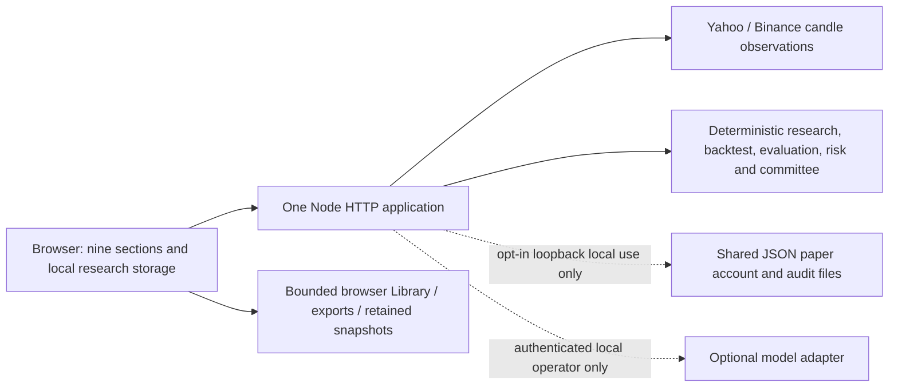

# Core platform audit — 21 October 2026

This is an audit of `Thaniyan/thn-ai-trader`, not an implementation or release.
Evidence was collected on 20–21 October 2026. Canonical main was fetched again
on 21 October and equals local HEAD: `fad7fe6d03f799bc699401e9fc31004e9b6c1087`.
The original checkout, recovery worktrees and prior evidence were preserved.
Only these audit documents and their curated evidence were added; no application,
test, workflow, dependency or hosting configuration was changed.

## Assessment

The strongest working product is a bilingual, deterministic market-research
workstation: independently retrieved candle histories, interactive charts, causal
structure heuristics, chronological strategy evaluation, hypothetical risk plans,
saved research and reproducible snapshot replay. It is not a production brokerage
platform, a durable multi-user account service or a validated generative adviser.

The newer research workflow is materially more rigorous than the retained legacy
panels. Passing the existing tests does not establish correctness across both:
additional probes found invented legacy journal outcomes, inconsistent closed-bar
boundaries, retry-sensitive local paper execution, denied-storage startup errors,
Broker Accounts accessibility failures and large repeated asset transfers.

Recommendation: continue the existing product, prioritize research truthfulness
and reliability, preserve AI and numerical engines, and keep hosted account and
execution endpoints unavailable. Do not market the current platform as supporting
verified broker synchronization or real-time execution.

## Evidence contract and baseline

Evidence labels used throughout this report and the [feature matrix](CORE-PLATFORM-FEATURE-MATRIX.md):

| Label | Meaning |
|---|---|
| S | Confirmed by source inspection at the audited SHA |
| T | Confirmed by established automated tests |
| L | Confirmed by targeted local runtime/browser testing; fixture data is explicitly identified |
| P-meta | Confirmed by authenticated Production platform metadata, not application behavior |
| P | Confirmed by a request against the live Production application |
| U | Not verified or not implemented; the surrounding text distinguishes these |
| B | Verification blocked by environment/access restrictions |

No feature receives P solely because a source route, screenshot, CI test or READY
deployment exists. The live health request encountered proxy CONNECT `403`;
the release's live Chromium request also encountered
`ERR_TUNNEL_CONNECTION_FAILED`. No bypass was created for this audit.

Authenticated Vercel metadata on 20 October identified Production deployment
`dpl_FnAvZx4CKVFYtY9dze8Z9Gry9BEL`, READY, exact audited SHA, in original project
`prj_IFLYEB85CRNBjDEGO69xcW4O55Wd`, assigned to `thn-ai-trader.vercel.app`.
This is P-meta. Functional Production checks, POST tests, actual provider behavior
from Vercel and live visual/accessibility results remain B, not passed.

### Completed verification, reused after the usage-limit pause

| Gate | Actual result |
|---|---|
| Build and lint | Passed; both are JavaScript syntax checks, not a semantic/static-analysis linter |
| Unit/integration/numerical suite | 136 passed, 0 failed/skipped |
| Legacy system suite | All 10 assertions passed against disposable local paper state |
| Dedicated security suite | 21 passed, 0 failed/skipped; overlaps some unit coverage |
| Browser gate | All 12 suites passed; actual production package, offline providers |
| Layout gate | 202 geometry cases; EN/AR, dark/light, 80–200% emulated zoom; no asserted shell overlap regression |
| Accessibility in established gates | Shell, research, Library, AI and existing workflow scans passed in their tested states |
| Additional all-section audit | 108 cases: 9 views × 3 widths (1440/820/390) × 2 languages × 2 themes; 0 page-overflow cases, 0 ordinary page exceptions |
| Additional accessibility | 10/108 cases had violations, all in Broker Accounts; reproduced in 10/12 focused settled-state scans |
| Denied-storage fault injection | Failed: startup exceptions; normal navigation results above do not cover this state |
| Workflow/source guard | Passed; canonical ancestry, source exclusions and numerical parity |
| Dependency audit | Initially blocked because Bun was not on PATH; rerun with the existing installed Bun succeeded, 0 advisories |
| Production package | 50 runtime source files; 54 inventoried artifact files plus the manifest itself; no test fixtures or runtime state |

Artifact manifest SHA-256:
`adf8138f39546517620c4f7a9686ddd59f279158d3be22f3b5a58c278a3dae25`.
Do not sum overlapping test counts as independent security assurances.
The 12-suite browser gate completed in 402.53 seconds; it was not rerun on resume.
The only resumed browser run checked previously unresolved findings.

Portable results are in [evidence.json](core-platform-evidence/evidence.json).
Detailed raw logs, probes and all 18 initial screenshots remain at
`/workspace/work/core-audit-20261020/`. Selected screenshots are retained beside
the portable evidence. All local financial/provider fixtures are synthetic.

## Architecture and active versus historical code

The production package uses Vercel Build Output API v3: one Node 24 function
wrapping `server.js`, all routes directed to that function. Even static assets
are served through it. No durable database, worker, scheduler or account identity
service is packaged. Function memory/cache/locks are process-local and disappear
or diverge across instances. They are not distributed coordination.

| Area | Active implementation and limits |
|---|---|
| Entry and shell | `public/index.html`, `app.js`, `style.css`, `workstation.js/css`; nine hash-based sections |
| Market/research state | `research-state.js`, `research-workstation.js`, `market-terminal.js`; shared instrument/interval with request freshness guards |
| Chart | `research-chart.js` canvas, keyboard inspection/pan/zoom, overlays, local drawings; legacy map and optional external TradingView remain |
| Research math | `server/research.js`, `backtest.js`, `evaluation.js`, `decision.js`, `replay.js`; frozen canonical parity enforced by CI |
| Research UI/data | `decision-core/records/workspace`, `research-quality`, `library-core`, `research-library`, `workflow-maturity`, `terminal-research` |
| Intelligence | Deterministic `server/intelligence.js`; optional authenticated providers and bounded local conversations; no model active |
| Paper/accounts | `accountStore.js`, `brokerAdapters.js`, `riskEngine.js`, `reconciliationEngine.js`; shared JSON, single operator, explicit local opt-in |
| History/recovery | Earlier Sprint 1 SQLite/authentication implementation survives in separate recovery history; it is not active canonical v7.1 functionality |

The active source is an integration onto canonical main history. `AGENTS.md`
explicitly prohibits claiming that all legacy Git history is sanitized. The
older independent-root `source-guard.mjs`/policy remains historical tooling;
the current release uses `release-guard.mjs` for canonical descendant/current and
newly introduced source checks. Do not run an incompatible historical migration
guard and interpret its expected ancestry mismatch as a new product defect.

Maintainability concerns: `app.js` has 6,081 lines, `style.css` 5,446 and
`server.js` 2,141 at baseline. Additional modules progressively rearrange existing
DOM nodes, intercept forms and maintain parallel legacy/new state. Several risk,
chart, translation and reporting paths coexist. This raises integration risk;
incremental boundary extraction is preferable to another full redesign.

README still calls this a local v7.0 release candidate and includes obsolete
authorization/version/history statements. Release notes and prior validation JSON
are historical evidence, not current Production status. The package describes an
automated copilot more broadly than its guaranteed hosted capabilities.
`@google/genai` is declared and locked but unused by the packaged runtime. Build
and lint repeat syntax checks; there is no typed API contract or general lint gate.

## Market data and chart assessment

S/T: Yahoo chart endpoints supply FX, equities/indices and commodity futures
proxies. Crypto attempts Binance spot first, then Yahoo. Aliases can map one
display symbol to different economic instruments/currencies: e.g. BTCUSDT may
become BTC-USD. Catalog mappings are candidates, not tested coverage guarantees.
Gold/oil observations are futures proxies, not executable spot contracts.

L-real: On 20 October, ordinary read-only local packaged requests using the
supported proxy returned 2,000 closed hourly bars for each of:

| Selection | Actual provider mapping | Omitted rows / gaps | Local request duration |
|---|---|---|---|
| EURUSD | Yahoo `EURUSD=X` | 97 / 18 | 0.90 s |
| XAUUSD | Yahoo `GC=F` | 812 / 85 | 0.99 s |
| BTCUSDT | Yahoo fallback `BTC-USD`, USD currency | 1 / 0 | 1.73 s |

These are one-time observations, not availability/latency SLAs. Omission totals
refer to the fetched provider payload; gap counts refer to retained history.
No price was fabricated. The probes do not prove Binance was operational, all
catalog/timeframe pairs work, or Vercel can reach these services.

The research path validates positive internally consistent OHLC, ordered unique
timestamps, interval cadence, closed bars, minimum history, volume and hashes.
It discloses discarded rows and gaps. Indicators include EMA20/50, Wilder RSI14,
ATR14; pivot-derived BOS/CHoCH, order-block/FVG/liquidity markers are causal
heuristics, not observed institutional orders. Raw FX volume is often absent;
volume profiles are bar-derived approximations, not exchange order flow.

There are important limits: only 15m/1h/1d independent research frames; up to
2,000 retained bars (Binance fetch caps at 1,000); no licensed tick/bid/ask book,
streaming feed, consolidated exchange entitlement, corporate-action normalization,
futures roll adjustment, point-in-time universe or exchange holiday/DST calendar.
Session display is fixed UTC-hour logic and not a verified exchange-open signal.
Professional data rights, redistribution terms and any broker-compatible executable
prices require a separate provider decision; free chart endpoints do not establish
those rights or service quality.

F02 below confirms inconsistent candle boundaries: the research path drops a
currently forming bar, while legacy analysis/scanner/quote paths can consume it.
The 30-second bounded cache is per process and preserves timestamps; it neither
guarantees freshness nor a shared snapshot across independent requests.

Charts genuinely support candles, EMA/RSI/volume, ranges/SMC, drawing lines/notes,
keyboard interaction and hypothetical plan overlays. Drawings are browser-local
per instrument/interval, not collaboration or broker orders. Optional TradingView
is a third-party display whose feed need not equal the internal dataset. It was
not tested online by offline CI; the internal chart remains the verifiable path.

## Quantitative and risk assessment

S/T/L: EMA, RSI recovery and prior-range breakout strategies support long-only,
short-only and long/short research. Closed-bar signals fill at the next observed
open. ATR stops/targets, stop-first ambiguous bars, adverse gap stops, fees,
spread/slippage, lot-step floor, margin and cap assumptions are implemented.
Metrics include return, expectancy, R, profit factor, drawdown contributors,
holding time, exposure, concentration and nonannualized per-bar Sharpe.
Undefined metrics are handled explicitly in the newer evaluator.

Development and holdout windows are chronological, flat/fresh capital per window;
development receives no subsequent test candles. Fixed-parameter expanding-window
walk-forward runs three disjoint tests when history suffices. Sensitivity explores
parameter and friction perturbations without selecting a winner. The evaluator is
bounded to 2,000 bars/18 runs and discloses small samples and repeated holdout use.
Replay validates saved engine, symbol, interval, OHLCV hash and recomputed metrics;
it does not authenticate the provider or make imported records trusted.

Not implemented: survivorship-free universes, corporate-action/roll-normalized
datasets, point-in-time fundamentals, borrowing/funding/carry, order-book impact,
liquidity fills, broker liquidation, calibrated probabilities or independent
strategy profitability validation. Manual symbol/parameter selection and repeated
holdout inspection can still bias conclusions. A browser inspection counter is
not an enforceable research registry. Automated causal tests are valuable, not a
proof that every market situation or third-party timestamp convention is correct.

Risk Desk's newer `/api/research/plan` validates finite bounded capital, side,
entry/stop/targets, cost assumptions, lot steps and USD conversions. It shows
independent target outcomes and warns when costs exceed budget or margin exceeds
capital. USD-base FX conversion is covered. Native USDT is not assumed USD for
that planner. Contract specs remain generic hypothetical values, not verified
broker product terms. There is no aggregated portfolio correlation, stress loss,
currency exposure, VaR or maintenance-margin model. Stops do not cap gap loss.

The older `/api/risk/calculate` has weaker validation (F07); direct ticket code
also expects obsolete response fields and omits required entry. Never treat its
fallback text as pre-trade approval. No mathematical engine was altered here.

## Confirmed findings and ranked technical debt

Severity reflects the affected scope. No live-money exploit or publicly exposed
account mutation was demonstrated. P1 denotes a high-priority integrity or
readiness defect; it does not mean an active Production emergency was verified.

| ID / priority | Finding and evidence | Impact / required correction |
|---|---|---|
| F01 / P1 | Legacy `saveJournal()` converts an unexecuted BUY/SELL analysis to WIN and `risk × rewardRisk` profit. Focused Chromium call saved a BUY idea as +$200/2R with target as exit. `parseTradesCSV('symbol\\nEURUSD')` invented entry/exit 1, risk 100, direction, grade, confidence and date. S/L, synthetic browser only. | Research must never become realized performance. Introduce explicit record kinds/provenance, quarantine incomplete imports and exclude ideas from outcome metrics while preserving old bytes. Legacy KPI also substitutes profit factor 9.99 when no losses and uses a $10k base; these are not broker performance. |
| F02 / P1 | Injected a current provisional bar closing 1.2: `/api/analyze` reported price 1.2 while `/api/research/series` retained prior closed close 1.0859034349929308. S/L fixture. | Adjacent panels can disagree without a common snapshot; indicators/signals change before close. Adopt a common verified closed-bar data boundary and label any separately displayed provisional observation. |
| F03 / P1-local | Same-key replay returns original paper ticket; submitting the same intent with a new key created two positions. Client generates a new key per invocation; server Map lasts five minutes/in-process and is not transactionally persisted. S/T/L. | Unsafe uncertain-result recovery and restart semantics. Stable client intent lifecycle, durable idempotency/fingerprint/result transaction and recovery/status query before widening paper availability. Hosted execution remains blocked. |
| F04 / P1 | Denying `Storage.getItem` caused `audit storage unavailable` and `Cannot access 'liveQuotesCache' before initialization`. Newer modules can partially initialize while legacy setup/events fail. S/L. | Add uniform guarded storage and memory fallback, persistent warning, no destructive repair; cover disabled storage, quota, corruption and reload. Current Library's fail-closed writes are stronger and must be preserved. |
| F05 / P1-readiness | No user registration/login/session system, tenant ownership or durable hosted account DB. Local files share one operator. S; hosted denial T/L. | Accounts are unavailable by design, not a complete multi-user service. Auth, owner scoping, backup and durable transactions are prerequisites to enabling them. |
| F06 / P2 | Broker Accounts has serious light-theme contrast failures (including advisory ~1.15:1) and a non-focusable scrolling positions shell at 820/390 px. Reproduced after 1 s with actual theme button; 10/12 focused cases. S/L. | Correct themes and scroll keyboard access; add these states to acceptance. Established a11y success did not cover this full matrix. |
| F07 / P2 | `/api/risk/calculate` accepts leverage -1 with 200/clamped result; JSON null returns generic 500. Legacy direct ticket omits entry and expects nonexistent `potentialLoss/potentialProfit/rewardRiskRatio`; catch says checks verified. S/L API; UI fallback source-only. | Reject malformed types/ranges with stable 4xx; reuse validated plan contract; eliminate success-like failure text. External execution still blocked. |
| F08 / P2 | Missing `.js` and `/api/auth/me` return HTML 200 through SPA fallback. S/L. | Explicit API/asset 404 and method contracts; avoid false-positive health and opaque module failures. Unknown SPA navigation can remain intentional. |
| F09 / P1-before-scale | Public research/analysis/scanner endpoints lack durable per-user/IP budgets and global admission control. 1 MB bodies are drained before rejection; replay/AI locks and market cache are process-local. S/T. | Bound request shapes/fan-out/output, execution time, concurrency and usage; plan distributed protection before public account/compute expansion. No load/penetration test was performed. |
| F10 / P2 | `logo.svg` is 4,027,258 bytes. The 108-case navigation probe fetched it 110 times (~443 MB), under application-wide no-store; all assets go through the function. S/L. | Optimize branding, avoid repeated DOM reloads, publish immutable static assets through CDN with separate API privacy headers. Local load 1.84 s is not mobile LCP or Production performance. |
| F11 / P1-before-broker | MT5/XTB/Exness adapters are incomplete; some configured-URL statuses claim connected without account/positions/orders implementation. External linking is blocked before those routes. S. | Remove capability assumptions; select currently supported documented read-only API/bridge, then contract tests and reconciliation. No broker API was contacted. |
| F12 / P1-before-hosted-paper | JSON writes are whole-file, nontransactional and catch persistence errors; parse failures can recreate a default account. Reconciliation is request-driven. SL/TP checks run in a browser timer using candle observations; no durable server worker. S. | Local-only limitation; durable ledger/atomic writes, restart recovery, risk state and honest worker liveness are required before claiming reliable unattended paper trading. |
| F13 / P2 | No application CSP on main HTML; third-party TradingView script; extensive innerHTML and mixed inline styles. Newer imports/exports escape and whitelist content; exports have restrictive CSP. S/T. | CSP rollout after inventory, trusted asset handling and expanded malicious-input coverage. This review found risk surfaces, not a demonstrated remote XSS exploit. |
| F14 / P2 | Plain JSON audit retains 200 records, is rewritable and redacts only selected top-level detail keys. Key file and encrypted state share local storage. S. | Do not call this immutable/compliance-grade. Add recursive redaction, durable event IDs/retention and key lifecycle only with an approved account architecture. No secret content was inspected or copied. |
| F15 / P2 | Duplicate state/DOM/risk/translation paths; stale docs; syntax-only lint; unused SDK. S. | Incremental boundary contracts and documentation index; preserve numerical golden fixtures before extraction. |
| F16 / P2 | Health lacks exact deployed SHA; no tested end-to-end Production monitoring/restore drill in audit, no app-level SLO or load data. Repository required-check enforcement not established by workflow text. S/B/U. | Release identity, read-only smoke evidence, explicit operational runbook and owner verification of branch rules; no settings changed here. |

The extreme 195-effective-CSS-pixel Risk Desk overflow is an existing documented
limit from v7.1 acceptance, not a newly reproduced defect here. The established
202-case shared-shell zoom gate and normal 390/820/1440 section checks passed.
Canvas screen-reader semantics, real assistive technology, iOS Safari, Android,
physical pinch zoom, slow-device Core Web Vitals and all expanded/modal/subtab
states were not exhaustively verified. Automated axe is not accessibility certification.

## Security and production reliability

Present protections (S/T/L): hosted financial gates precede account handling;
live execution is rejected; local AI requires explicit bearer authentication,
loopback peer/Host and no forwarding headers; recognized hosted runtimes deny
generation; request bodies are bounded; fixed provider destinations avoid generic
URL proxying; cross-origin POST with a mismatching Origin is rejected (403 probe).
No wildcard allow-origin header is set. Static files are confined to public paths;
error responses suppress generic internal exceptions. Libraries validate bounds,
escape user text, strip unknown fields and mark imports unverified. Source/package
guards exclude private runtime files and test fixtures. Actions are pinned and CI
permissions are read-only. Advisory results were zero at the recorded check time.

Limitations: Origin validation is not user authentication or full future CSRF
protection; missing Origin is accepted and no identity exists for local paper.
Do not expose that local service via tunnels. Before cookie sessions, require
secure HttpOnly/SameSite cookies, CSRF protection, session rotation/revocation,
auth callback controls and ownership on every object. No backend RBAC exists for
research/account tenancy. Resource exhaustion and quota risk remain even while
money execution is disabled. No authenticated penetration test, independent
security assessment or exhaustive secret-history certification was performed.

The current workflow's three jobs are good release evidence but do not prove
GitHub branch rules enforce them or Vercel waits for CI on every push. Main pushes
normally trigger Vercel independently; `develop:false` does not suppress all
feature previews or manual/integration triggers. Actual branch rules, installed
app/webhook inventory and current usage allowance need owner-side verification
before changing release governance. This audit made no such changes.

## AI preservation and status

S/T: v7's six roles (technical, quantitative, bull, bear, risk, manager) select
and interpret validated evidence deterministically. References carry timestamps,
dataset identity and uncertainty. Saved research is labeled unverified; reflections
observe later bars without rewriting the original or training a model.

v7.1 offers an optional genuine model protocol path only for an explicitly
configured operator-local runtime: literal loopback port 11434, fixed tags/show/chat
paths, installed tag/digest/size checks, no model download/tool API, bounded
conversations/rounds/timeouts/output and cancellation. Structured claims must equal
cited deterministic values; model arithmetic, conflicting context and unsupported
numeric/news/probability output are rejected. Free prose is still semantically
unverified. Local service metadata is not trusted-weight attestation.

No real model was run; no Ollama started, weights downloaded or paid API used.
Protocol/browser generation tests used a synthetic fixture. Real-model factual
accuracy, EN/AR quality, latency and memory remain U. Process budgets are not a
distributed public spending control. Hosted inference is disabled even if model
configuration exists; GET availability and POST denial were confirmed locally in
hosted mode. Live Production AI behavior remains B. Preserve this architecture,
but do not add agent autonomy or spend until core platform work warrants it.

## Operating envelope and next decision

GO for continued local core reliability engineering and limited research use with
clear disclosures. NO-GO for calling this a professional multi-user broker/trading
service, enabling hosted paper/live execution, claiming model validation or
guaranteed durable accounts. Free browser research can remain useful; durable
accounts and unattended synchronization require explicit architectural decisions.

See [broker/accounts architecture](CORE-PLATFORM-ACCOUNTS-AND-BROKERS.md) and
[ranked roadmap and first milestone](CORE-PLATFORM-ROADMAP.md). All findings are
recommendations only; implementation and any later exact-SHA release need their
own owner authorization. No commit, push, merge, deployment, settings change,
resource creation or purchase was performed for this audit.
