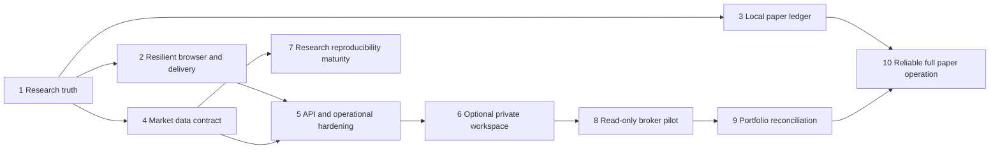

# Core platform engineering roadmap

Planning baseline: `fad7fe6d03f799bc699401e9fc31004e9b6c1087`.
Prepared 21 October 2026; original repository, website and v7.1 features retained.
This document does not authorize implementation, publication or infrastructure.
Read the [audit](CORE-PLATFORM-AUDIT.md), [matrix](CORE-PLATFORM-FEATURE-MATRIX.md)
and [account/broker feasibility](CORE-PLATFORM-ACCOUNTS-AND-BROKERS.md) together.

## Top ten priorities, in order

| Rank | Priority | Evidence / why now | Milestone |
|---|---|---|---|
| 1 | Stop research ideas and incomplete imports becoming realized performance | F01 confirmed in local Chromium; directly compromises product trust | M1 |
| 2 | Apply one explicit closed-bar/snapshot contract across analytical journeys | F02 provisional-bar disagreement reproduced; avoid conflicting evidence | M1 |
| 3 | Survive blocked/full/corrupt browser storage without losing work | F04 confirmed startup errors; Library already has preservation mechanisms worth retaining | M2 |
| 4 | Make local paper intents restart-safe and auditable before expanding exposure | F03/F12 duplicate and nontransactional state; hosted restrictions must remain | M3 |
| 5 | Fix Broker Accounts contrast/keyboard access; preserve released shell | F06 settled-state failures despite passing narrower existing gates | M2 |
| 6 | Reduce asset/function overhead without changing visual identity | F10 4 MB logo fetched repeatedly; free quotas are scarce | M2 |
| 7 | Standardize API validation, errors and bounded public work | F07–F09; avoid false-success fallbacks and uncontrolled provider/compute fan-out | M4/M5 |
| 8 | Formalize market instrument identity, provenance, history quality and sessions | Futures/spot and USD/USDT differ; free feed coverage/rights are not guaranteed | M4 |
| 9 | Add durable private workspace only after identity/ownership/backup design is approved | F05; active code has no multi-user authentication or cloud DB | M6 |
| 10 | Establish production evidence, governance and then one read-only broker path | F11/F16; no connected provider or verified continuous runtime | M5/M8/M9 |

AI expansion is deliberately below these priorities. Preserve deterministic
assistant/committee, bounded local model integration and disabled hosted inference.
No new generative agents, subscriptions, model weights or trading autonomy are
needed for this roadmap's first stages.

## Ranked technical debt register

| Rank | Debt / finding IDs | Disposition and dependencies |
|---|---|---|
| 1 | Mixed research/outcome records and parallel data boundaries (F01/F02) | Resolve at user-visible trust boundary first; no numerical algorithm rewrite |
| 2 | Fragile browser state and uneven storage guarantees (F04) | Uniform storage adapter; preserve canonical Library and legacy source bytes |
| 3 | Nontransactional local execution/idempotency/audit (F03/F12/F14) | Local ledger integrity before cloud paper; no external execution |
| 4 | Accessibility coverage holes (F06) | Settled-state matrix plus populated/empty/error broker views |
| 5 | Monolithic static function delivery and repeated branding loads (F10) | CDN/static separation, versioned caching, smaller assets; preserve API no-store |
| 6 | Weak older API contracts and false success/missing route semantics (F07/F08) | Explicit schema/status tests; remove misleading fallback text |
| 7 | Resource/abuse limits only per process (F09) | Bounded work now; distributed budgets with approved data service later |
| 8 | No identity/tenant data boundary (F05) | Not patched by enabling account routes; design/negative tests before rollout |
| 9 | Adapter/reconciliation placeholders (F11) | Provider eligibility and contract fixtures before any credential connection |
| 10 | CSP, redaction and operational visibility gaps (F13/F14/F16) | Incremental hardening; no unverified security-compliance claims |
| 11 | DOM/state/translation layers, duplicate logic (F15) | Extract boundaries after golden workflow tests; no large frontend rewrite |
| 12 | Stale docs and historical tooling presented as current (F15/F16) | Current capability/architecture index; archive notes remain intact |

## Delivery dependencies and approval boundaries

M2/M3/M4 can overlap only when independently scoped and reviewed. Do not combine
them into an unreviewable release. Estimates below are focused engineering effort
for an engineer familiar with the code, including regression work; not calendar
promises, staffing estimates or guarantees about provider/owner lead times.

Every implementation milestone needs a new owner go-ahead because the present
authorization is audit/planning only. Every remote publication/deployment requires
separate exact-commit release approval and all existing mandatory CI. Later service,
account/credential, provider and architecture decisions require the additional
approvals stated below. No milestone silently reuses past release authorization.

## M1 — Core research trust (recommended next)

**Objective/value:** a user can inspect a consistent closed-candle analysis, save
an idea and import a record without the application inventing realized results.
Removes the most consequential confirmed core-platform misinformation at zero cost.

**Deficiencies:** F01/F02; legacy journal auto-WIN and fabricated CSV defaults;
performance metrics aggregate incompatible records; raw/provisional observations
can enter legacy analysis next to a different closed research snapshot.

**Exact implementation scope:**

1. Introduce explicit provenance/kind for research ideas, user-entered/imported
   unverified outcomes and local-paper settled outcomes. A saved analysis is an
   idea with no realized PnL, exit, win/loss or execution timestamp. Keep all old
   records; present ambiguous old rows as unverified, never silently “repair”
   their source bytes or delete history.
2. Require actual fields for an imported outcome; preview/reject or quarantine
   incomplete/nonfinite rows with row-level explanations. Never invent date,
   direction, entry, exit, risk, grade, confidence or dollar profit. Imported
   research/outcomes remain unverified even if shape is valid. CSV exports must
   safely encode untrusted values, including spreadsheet-formula prefixes.
3. Performance views must explicitly select a compatible outcome source and capital
   basis, show counts/exclusions, and never mix ideas with closed trades. Missing
   basis/undefined profit factor must be unavailable, not a fabricated $10k result
   or 9.99 ratio. Manual/imported data is not a verified broker track record.
4. Put legacy analysis/scanner observations behind the established validated
   closed-candle boundary for analytical use. Share/declare symbol, economic
   mapping, interval, close time, hash and state. Any separately displayed forming
   candle is explicitly provisional and cannot silently become analytical evidence.
   If a legacy panel uses a separate snapshot, label it and prevent cross-context
   transfers. Preserve the authoritative numerical modules byte-for-byte.
5. Keep existing EN/AR labels, Library/backup formats and nine sections compatible.
   Update only affected capability/methodology text and regression coverage.

**Not in scope:** new UI design system, account auth/DB, broker linking, cloud
paper execution, live trading, AI features, new data provider or model activation.

**Dependencies/security:** current clean main and existing source/CI guards;
whitelist imported shapes, escape text, preserve unknown source records safely,
no inference/trading routes changed. Storage upgrades beyond safe affected writes
belong to M2; no global migration that can overwrite user data.

**Acceptance criteria (all required):**

- Saving ten BUY/SELL ideas creates ten ideas, zero closed trades, zero realized
  profit and zero fabricated exits. Reload/export/import preserves that distinction.
- A one-column `symbol` CSV and missing/nonfinite dates/prices/risk values cannot
  produce completed trades; preview identifies the rejected fields/rows.
- The reproduced old +$200 “WIN” remains recoverable but is not automatically
  counted as an authenticated outcome. Imported and manual records stay labeled.
- Zero-loss/zero-trade results have explicit undefined reasons; returns without
  capital basis are not displayed as verified percentages. Outcome numbers reconcile
  to the selected valid records and documented capital/fee assumptions.
- An injected current/future/incomplete candle cannot change closed analytical
  indicators/signals. Same symbol/interval/hash yields the same observed close in
  connected panels. Changed/stale/missing evidence is labeled or rejected.
- All nine sections, Library exports/replay, deterministic committee and previous
  responsive shell still work; hosted finance/generative requests remain denied.
- Existing numerical modules unchanged; all mandatory CI-equivalent tests pass,
  with additional fixtures for the previously uncovered bugs. No skipped assertions.

**Tests:** record-kind/schema/legacy compatibility; malformed/quoted/multiline and
formula-like CSV; manual outcomes; source-filtered metrics; current-bar and
close-boundary/future-bar fixtures; rapid selection/failure; EN/AR/RTL desktop,
tablet/mobile/dark/light and existing 80–200% shell geometry; XSS/import bounds;
complete existing test/security/browser/dependency gates. Production tests only in
a later approved release, with access limitations recorded honestly.

**Risk/complexity:** medium-high, about 5–8 engineering days because compatibility
and two competing analytical paths need careful tests. **Free sufficient:** yes,
local implementation and existing Vercel research architecture. **Production
architecture change:** no service/hosting change. **Approval:** local implementation
scope first; separate exact-SHA release later. This is the single recommended
first milestone for owner approval.

## M2 — Resilient workspace, accessibility and efficient delivery

**Objective/value:** keep research usable under storage failure and reduce repeated
downloads without another redesign. **Gaps:** F04/F06/F10, inconsistent legacy
storage errors and broker light-theme/scroll accessibility.

**Plan:** wrap browser storage behind a guarded interface with in-memory fallback,
clear persistent warning and explicit export; do not overwrite corrupt/unreadable
data. Retain Library capacity/restore guarantees. Correct Broker Accounts contrast
and focusable scroll semantics in all states. Optimize the logo while preserving
branding, stop redundant reloads and package immutable static assets for CDN
delivery; keep APIs/private responses no-store. Add stable asset identity and
document browser-only deletion/backup scopes.

**Dependencies/security:** M1 record contracts; no secrets in local storage;
do not cache private API responses or accidentally include runtime files in static
output. **Acceptance:** blocked read/write/quota/corruption never crashes startup
or silently erases data; all nine views remain navigable; settled Broker Accounts
WCAG AA automated checks clear in all 12 profiles and scrolling is keyboard usable;
logo transfer <=100 KB without material visual regression and repeat navigation
does not redownload identical branding; stale assets cannot mismatch HTML releases.

**Tests:** storage fault injection/reload/multi-tab compatibility, retention and
backup; actual theme-button and empty/populated/error views; axe and keyboard,
EN/AR/RTL/zoom; screenshot comparison; route/cache/header/package-integrity checks;
local network bytes plus device/Production measurements when accessible.
**Risk/effort:** medium, 4–7 days. **Free sufficient:** yes within existing quotas.
**Architecture:** static delivery changes within the same Vercel project, no new
service. **Approval:** implementation and later exact-SHA release; any actual
hosting-setting change requires separate authorization and is not assumed necessary.

## M3 — Transaction-safe local paper engine

**Objective/value:** dependable single-operator paper intent/settlement and recovery.
**Gaps:** F03/F12/F14; retries, restart, whole-file persistence, browser-timed brackets.
**Plan:** review preserved SQLite modules as source-only candidates; add a local
transactional order-intent/ledger repository, persistent fingerprint/idempotency
result, stable client intent through uncertain responses and a status query.
Atomic account locks/settlement/audit, partial-close math and explicit stale-price
rules. Keep localhost-only opt-in and distinguish request-driven versus monitored
brackets; never imply a server worker exists unless implemented/tested locally.

**Dependencies/security:** M1, trusted generic contract assumptions, private local
data path and backup. No live adapter activation. **Acceptance:** response loss,
same/new transport attempt, process crash/restart cannot execute one logical intent
twice; rejected persistence cannot report fill success; partial closes/balances
reconcile; invalid/stale prices fail closed; no hosted execution enabled; restore
and audit replay tested. **Tests:** crash injection, restart, concurrency, key/payload
conflict, duplicate settlement, invalid quotes, risk caps, corruption/backup restore.
**Risk/effort:** high, 7–12 days. **Free sufficient:** local only; hosted unattended
operation not promised. **Architecture:** local storage boundary only; SQLite never
used as durable Vercel storage. **Approval:** local scope; any worker/broker exposure
or hosted paper rollout separately prohibited until approved.

## M4 — Market-data identity and quality contract

**Objective/value:** analysis describes the actual instrument and quality of its
history. **Gaps:** F02/provider mapping, USD-USDT and futures/spot ambiguity,
static session assumptions, incomplete history/rights verification.
**Plan:** one typed/validated instrument registry with provider/economic identity,
quote/account currencies and contract eligibility; explicit provider attempt/fallback
metadata, closed/provisional state, as-of/last-close/fetch timestamps, omission/gap
diagnostics and cache identity. Distinguish closed markets from stale feeds without
claiming a licensed exchange calendar. Verify selected provider terms/coverage;
support unavailable states rather than inventing substitutions.

**Dependencies/security:** M1; approved free sources, no paid feed. Bounded allowlist,
timeouts, response size and fan-out. **Acceptance:** changing provider/currency
cannot silently preserve the wrong risk contract; proxy identity visible everywhere;
all supported frame mappings have frozen contract tests and current read-only probe
results; no fabricated prices; volume/session data limitations explicit.
**Tests:** weekend/session gaps, DST boundaries where supported, missing/duplicate
rows, adjustments/revisions, stale/incomplete bars, fallback currency change,
HTTP failure/timeout and cache coalescing; numerical golden outputs unchanged.
**Risk/effort:** medium-high, 5–9 days. **Free sufficient:** bounded indicative
research; professional executable data/rights not guaranteed. **Architecture:** same
Node app initially. **Approval:** implementation; new provider or entitlement later.

## M5 — API hardening and observable release operations

**Objective/value:** bounded honest errors and verifiable releases. **Gaps:**
F07–F09/F13/F16, no exact SHA health, unknown rule enforcement and Production tests.
**Plan:** common API schemas/statuses, explicit API/asset 404s and 4xx malformed
JSON types; remove false-success catches. Bound scan and evaluation work, cancellation,
request/output sizes and concurrency; prototype resource limits without a destructive
load test. Add safe correlation/error/latency/provider-availability telemetry,
recursive redaction and exact build identity. Inventory external scripts and stage
CSP changes using local evidence first. Document CI/branch/main/Vercel trigger and
rollback controls; owner verifies rules/settings, without changing them by assumption.

**Dependencies/security:** M2/M4; do not remove current origin/financial/AI guards.
Distributed quotas remain conditional on approved durable infrastructure.
**Acceptance:** stable 4xx contracts, no API HTML false positives, bounded oversized
and repeated work, no confidential logs; build SHA identifies deployed code; owner
can perform a read-only health/asset/financial-denial smoke and retained rollback
drill under explicit release approval. No failing check bypassed.
**Tests:** malformed/null/array bodies, traversal, methods, origin, CSP/XSS cases,
resource budgets/timeouts/cancellation; deployment package identity and approved
live smoke. **Risk/effort:** medium-high, 5–9 days. **Free sufficient:** basic hardening;
global anti-abuse/SLO depends on service limits. **Architecture:** same project;
optional distributed mechanisms require approval. **Approval:** local scope first;
branch/security/cloud settings, live smoke and rollback actions separately approved.

## M6 — Optional authenticated private research workspace

**Objective/value:** private multi-device research without shared account data.
**Gaps:** F05; no user auth, tenant DB or managed backup. **Plan:** original app plus
managed Auth/Postgres candidate from the account design, server-side identity,
ownership/RLS, bounded reports/plans/preferences/snapshots, explicit local import,
version conflict resolution, export/delete and tested backups. No brokerage tokens
or financial mutations in this milestone.

**Dependencies/security:** M1/M2/M5 and owner approval for the data/auth resource,
terms, region, pause/quotas and consent. **Acceptance:** two-user read/write/delete/
export isolation, session expiry/revocation/CSRF tests pass; local browser work
is preserved; DB outage is honest; off-site backup restores within proposed pilot
objectives; free quotas are measured and hard limits prevent surprise upgrades.
**Tests:** RLS/IDOR negative matrix, session/callback, concurrency/conflict,
capacity/deletion/backup restore, offline/paused DB and EN/AR workflows.
**Risk/effort:** high, 10–15 days plus provider/owner lead time. **Free sufficient:**
small accepted-limitation pilot, not an SLA. **Architecture:** yes, approved durable
external auth/data boundary; no new website. **Approval:** explicit resource,
security/environment configuration and later release required. Otherwise blocked.

## M7 — Research reproducibility and comparison maturity

**Objective/value:** stronger defensible experiments, not more attractive scores.
**Gaps:** manual selection/holdout reuse bias, limited snapshots, no normalized
point-in-time universe and incomplete comparability. **Plan:** versioned experiment
manifests, explicit data/license/period/cost identity, immutable retained inputs,
comparable/incomparable result groups, inspection history and calibration labels.
Preserve deterministic engines; verified defects require isolated numerical review
and updated golden evidence rather than silent changes. Do not imply significance
or future probability from the existing heuristic quality rubric.

**Dependencies/security:** M1/M4; M6 only for durable shared history. Hash integrity
is not provenance authentication. **Acceptance:** reproducing the same retained case
is deterministic; changed engine/data/cost/window always flagged; development never
sees future holdout bars; invalid imports cannot gain verified status; omitted-data
limitations remain visible. **Tests:** frozen independently checked numerical cases,
truncation/causality, engine/version migration, replay mismatch and comparison groups.
**Risk/effort:** medium-high, 5–10 days. **Free sufficient:** bounded local research;
large historical data warehousing not guaranteed. **Architecture:** no change for
local manifests, optional approved DB later. **Approval:** implementation; any new
data license, numerical algorithm or cloud retention expansion separately reviewed.

## M8 — One read-only broker pilot

**Objective/value:** trustworthy account observation before any execution.
**Gaps:** F11; current adapters are not working integrations. **Plan:** phase A in
the broker design: verify one official provider/region/API agreement and sandbox;
delegated read-only scopes, consent/revocation, server tokens, sourced snapshots.
Do not “finish all brokers” in one sprint.

**Dependencies/security:** M5/M6, provider eligibility and separately authorized
read-only account access, encryption/key rotation/log redaction. **Acceptance:**
real responses, timestamps and failure states, no invented connected status,
wrong-tenant/token failures denied and no order permission/path; source contract
tests precede real access. **Tests:** OAuth/consent/revocation, expired tokens,
pagination/limits, missing fields, signed events where applicable, scope/IDOR and
sanitized fixture replay. **Risk/effort:** high, 7–15 days excluding provider review.
**Free sufficient:** unknown until provider eligibility/terms are verified.
**Architecture:** request-based read-only flow may fit; persistent bridge does not
exist in current Vercel runtime. **Approval:** provider agreement, read-only scope,
token handling and any infrastructure; no trading approval.

## M9 — Portfolio synchronization and risk visibility

**Objective/value:** correct sourced balances, holdings and exposure with explicit
freshness. **Gaps:** no real multi-account reconciliation/portfolio risk.
**Plan:** phase B: typed cash/position/order/fill model, external event IDs,
occurrence/ingestion times, paginated snapshots, transactionally deduplicated cursors
and discrepancy state; on-demand refresh first. Add instrument/currency exposure
and bounded stress scenarios only from authoritative contracts and observations.

**Dependencies/security:** M4/M6/M8; durable tenant data and provider quotas.
**Acceptance:** duplicate/out-of-order/partial snapshots never corrupt balances;
outages preserve stale last-known positions; exposure reconciles to selected broker
accounts, with conversion/quote age explicit. No fabricated “synchronized” state.
**Tests:** lifecycle reconciliation, splits/fees/currency/partials, clock skew,
pagination gaps, webhook signatures, cross-user cases, independent exposure totals.
**Risk/effort:** high, 10–20 days. **Free sufficient:** limited on-demand pilot
possibly; continuous daemon/streaming is unverified. **Architecture:** durable data
plus optional separately approved worker if required. **Approval:** read-only sync
and provider/runtime scope, no live execution.

## M10 — Full paper-operation readiness; live execution remains deferred

**Objective/value:** a safe realistic simulated trading lifecycle with reliable
stops and recovery, rather than an unreliable public order button.
**Gaps:** F03/F12 and current lack of dependable continuous runtime/data.
**Plan:** phase C: combine transactional intent/settlement repository, sourced
contract/quote eligibility, cumulative exposure/daily caps, monitored bracket
lifecycle, reconciliation, audit and owner kill controls. Financial AI remains
advisory only. Explicitly distinguish reduced on-demand ledger from unattended
engine if no compatible infrastructure is approved.

**Dependencies/security:** M3/M4/M5/M6/M9, a proven durable worker/scheduler/data
path and independent review. **Acceptance:** race/crash/retry tests prove one intent,
atomic risk checks and balanced ledger; stops/outages/gaps have deterministic
documented semantics; liveness failure never claims monitoring; rollback/recovery
and backup drill pass; hosted live routes still deny all execution.
**Tests:** uncertain network outcomes, restart/partition/concurrent orders, atomic
risk limits, partial fills/close, cost/gap cases, session/tenant negatives and
independent reconciliation/restore scenarios.
**Risk/effort:** very high, 15–25+ days after infrastructure feasibility; no calendar
promise. **Free sufficient:** not established for continuous operation; do not
provision paid resources to fill the gap. **Architecture:** yes if hosted durable
worker/ledger is approved. **Approval:** explicit paper/runtime/data/operational
scope. Live execution is a future independent program (phase D), not an automatic
milestone exit or part of this roadmap's authorized work.

## Release discipline for every future milestone

Work from current canonical main, preserve the responsive fix and recovery source,
and isolate one reviewed scope per candidate. Keep all three hosted CI jobs and
their assertions, numerical parity, package exclusions and source guards. Resolve
real test failures; never weaken them to match a feature. A source change after
approval needs a new exact-SHA release decision. Verify deployment identity and
actual live behavior separately; if network access blocks it, state that limitation.
Retain a working rollback deployment and data-format compatibility; Git rollback
alone is not database recovery. Never force-push or merge historical recovery
ancestry to regain old source modules.

## Decision requested after this audit

Approve **M1 — Core research trust**, with the five scope items and acceptance
criteria above, for local implementation only. It delivers a concrete improvement
to the original platform without a new service, redesign, paid API or financial
activation. Production publication remains a separate exact-commit decision.
