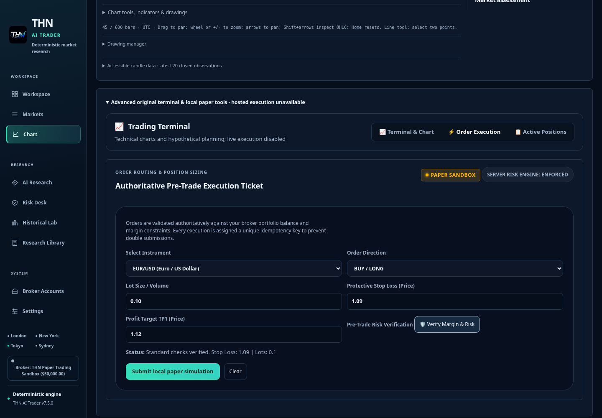
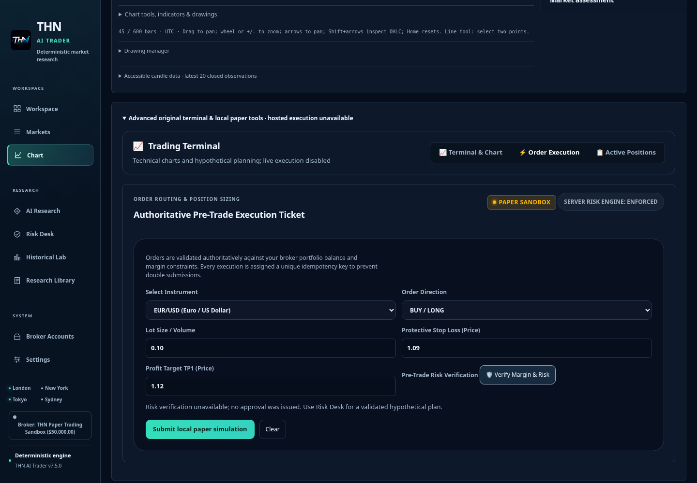
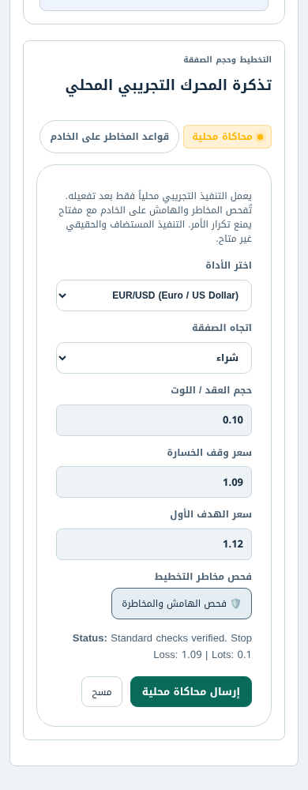
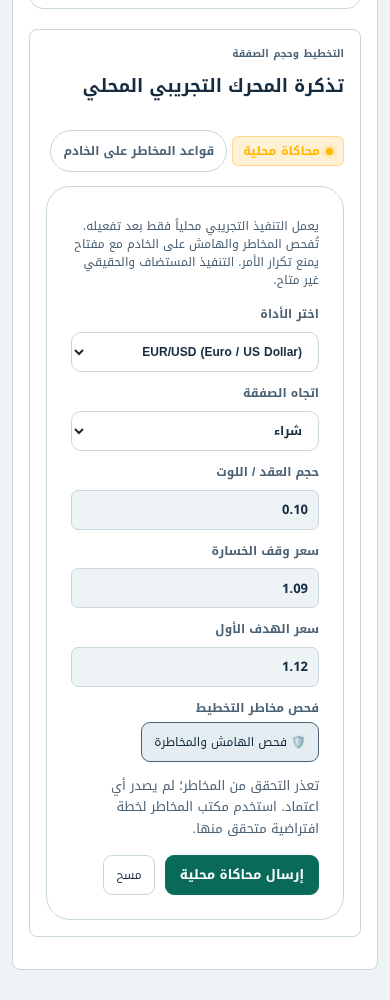

# M1 acceptance correction — truthful legacy ticket risk results

Branch: `feature/unified-decision-workstation-20261107`. Recovery checkpoint and
original PR #14 head: `28f5d1a69540c7233c17a23702741b398eebe879`.
Main/rollback reference: `a752fa4f533b0376c8d60eab1a450c5fbf9932f9`.
This correction requires the same major-change acceptance as PR #14; it is not
an authorization to merge or deploy.

## Reproduced defect and smallest correction

A controlled aborted `/api/risk/calculate` request in the enabled **local paper**
ticket produced “Standard checks verified” in both English and Arabic layouts.
Hosted ticket inputs remained disabled; the initial hosted probe correctly could
not edit them. No account, broker or Production operation was activated.

The success renderer also expected obsolete metric names. Its resulting type
error used the same false-success catch. The corrected renderer checks HTTP
success and finite nonnegative `requiredMargin`, `slDollars`, `tpDollars` and
`rrRatio` fields before displaying a **hypothetical estimate**, never APPROVED.
Network, malformed and rejected responses now say that no approval was issued,
in English/Arabic. Rendering uses text, including error states. An unused
fabricated balance fallback was removed from the request. Financial algorithms,
server validation, execution restrictions and saved-record schemas are unchanged.

**Not repaired here:** the old ticket request still lacks an explicit entry
assumption, and the legacy endpoint still accepts invalid leverage / responds 500
to JSON null. The functional Risk Desk `/api/research/plan` remains the existing
authoritative planning path. The legacy contract needs an isolated M3 correction;
this presentation repair does not claim to complete it. Positive renderer tests
use an explicit response-protocol fixture, not an actual successful legacy ticket
calculation or execution.

## Actual verification

After correction: build and syntax-only lint; 266 core/unit/integration/numerical
checks; 21 security tests; ten isolated system checks; workflow validation;
production packaging; frozen unchanged dependency inputs; zero-advisory fail-closed
audit; canonical ancestry/current-source exclusions and six-engine parity passed.

The complete local Paper Review browser suite passed, preserving draft handoff,
within-budget/over-budget restrictions and **zero submitted orders**. Added cases
cover failed transport, HTTP error, malformed metrics, untrusted error markup,
actual metric-field presentation, and EN dark desktop / AR light mobile layouts.
The full final-code 33-suite regression is additionally required through the
existing PR CI; its outcome must be observed against the exact updated head before
acceptance. No previous 28f5d1a result is represented as a run on the correction.

Before correction, independent unchanged-candidate checks passed: the integrated
16-profile journey, 288 professional layouts, 72 accessibility scans, 36 additional
1024px view/theme/language cases, 266 core tests and 21 security checks. Those
remain checkpoint evidence, not final-code full-suite evidence.

## Matching actual screenshots — synthetic local paper only

| Profile | Before failed request | After failed request |
| --- | --- | --- |
| 1440px EN dark |  |  |
| 390px AR light |  |  |

Both captures use native enabled controls, the same explicit ticket inputs and a
failed read-only risk request. Local paper uses a disposable synthetic directory;
no real credentials, orders or balances are evidence here. Preview/browser and
Production verification are separate. The workspace proxy currently rejects
Vercel HTTPS CONNECT with HTTP 403; protection was not bypassed.
