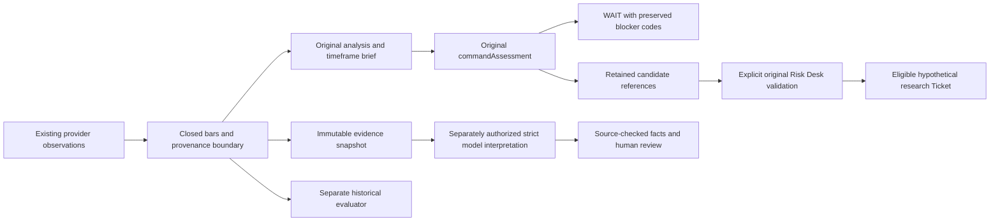

# Operational capability audit — owner release remains withheld

19 November 2026. Owner scope:
[PR23 comment7005335553](https://github.com/Thaniyan/thn-ai-trader/pull/23#issuecomment-7005335553).
Baseline: `79a446eb27593f7e1cba5492d6a0ac4c020a82c2`.
Existing draft PR23 / `feature/ai-evidence-interpreter-phase2-20261116` only.
The earlier Day5 UI and Day6 Ticket approvals are a foundation, not final product
acceptance. The current candidate does **not** establish an operational hosted
AI research service or a genuinely eligible live-provider Ticket. Day7 was an
assessment milestone. No merge, Production, provider purchase, new model,
hosted/paid inference, financial execution or security-policy change is authorized.

## Updated owner Windows evidence — same day

[Owner observation and next acceptance](PROVIDER-QUALIFICATION-20261119.md)
supersedes any universal absence-of-data interpretation of the earlier Cloud
observations below. Owner Windows returned27 successful research API responses
across nine contexts with recent available frames. EURUSD quality/neutral reasons,
BTCUSDT/USD scope mismatch and GC=F futures/spot incompatibility remain blockers.
No real candidate was retained. Posted aggregates do not determine individual
rejection causes or verified session closures. A1 is partial owner-device
reachability; C1 remains NOT_VERIFIED; B1 remains NO_GO. The matrix below records
the earlier Cloud audit, not a failed Windows connection or a provider outage.
The new aggregate taxonomy changes no qualification or execution policy.

## Capability and blocker matrix

VERIFIED_REAL means an actual non-fixture observation, not a marketing claim.
VERIFIED_OFFLINE means original code exercised with controlled evidence. BLOCKED
means the required runtime/resource/access is unavailable; UNVERIFIED means no
adequate observation establishes the capability. A real error response does not
verify real market prices. Evidence is linked below rather than inferred from UI.

| Capability | Status | Evidence / dependency | Responsible owner |
| --- | --- | --- | --- |
| Reach Yahoo query1/query2 from Cloud | BLOCKED | Both normal GETs receive Envoy CONNECT403 before TLS; no provider response or prices | Environment owner, approved network access only |
| Reach Binance from Cloud | BLOCKED | Same CONNECT403; not an observed Binance rejection | Environment owner |
| Existing unmocked packaged API failure path | VERIFIED_REAL, failure only | EURUSD/BTCUSD/XAUUSD ×15m/1h/1d: series and analysis return503 MARKET_DATA_UNAVAILABLE; brief frames fail; no substituted prices | Engineering |
| Current native OHLC values, timestamp/volume/gap counts | UNVERIFIED | No actual bars obtained; null remains null, request timestamps are not provider timestamps | Data owner / QA |
| Verified provider license / commercial redistribution rights | UNVERIFIED | No credentials or subscriptions used; public endpoint accessibility is not a license | Product/data owner |
| Original deterministic analysis / historical evaluator / hypothetical planner | VERIFIED_OFFLINE | Required numerical/API/UI gates, with protected engines unchanged | Engineering / independent QA |
| Eligible Entry/SL/targets on real feed | UNVERIFIED, release blocker | No real eligible sample; existing synthetic BUY/SELL cases only establish UI integrity | Product/financial owner |
| Local Ollama in this Cloud workspace | BLOCKED | Literal127.0.0.1:11434 inventory connection refused; no generation, install or download | Runtime owner |
| Owner Qwen3:1.7b / i7-7600U configuration | BLOCKED — NO_GO for the reported trial | Owner's actual12s timeout,12003ms settlement,3ms overrun; generation unsettled and no response. Not independently rerun here | Model/hardware owner |
| Alternative installed local model | UNVERIFIED | Owner-device inventory/digest and accessible test hardware not supplied; no alternative assumed installed | Model owner |
| Local strict interpretation pipeline | VERIFIED_OFFLINE | Digest/context/citation/claims/roles/opposition/unknowns/deadline/cancel tests; mocks never qualify a real model | Engineering / independent QA |
| Existing OpenAI adapter for strict Phase2 | BLOCKED by contract incompatibility | Minimal legacy request/validation drops the strict generation fields; no external call made | Engineering/security review |
| Hosted model serving | BLOCKED by design | providerAvailability disables generation on Vercel; local loopback points to server host, not owner's Windows PC | Owner, separate architecture/cost approval |
| Independent TradingView candles | UNVERIFIED by this audit | Separate display/venue feed, never native THN analytical source; prior Preview interaction is proxy-blocked | Owner walkthrough |
| Financial execution | BLOCKED by policy | Research only; PR17 / Issue18 approval remains separate | Financial/security owner |

No row labels a real market feed or model as qualified. Full exact-head CI and a
successful Preview deployment are necessary engineering evidence, not substitutes
for real-provider and real-model qualification.

## Gate A — actual provider wiring and observed failures

Source: [server.js](../server.js), [closed-market boundary](../server/market-evidence.js),
[frozen series engine](../server/research.js), [instrument identity](../public/instrument-identity.js).
The new diagnostic disclosure is under existing **Exact source & methodology**;
it does not change the accepted first-page layout or start provider/model requests.

| Instrument family | Actual order / mapping | Current limit |
| --- | --- | --- |
| FX | Yahoo query1 then query2, e.g. EURUSD=X, USDJPY=X | Currency must match quote; non-continuous session history may carry gap blockers |
| BTC/ETH | **Binance first**, e.g. BTCUSDT spot, then Yahoo BTC-USD fallback | USD and USDT are different. USD catalog maps BTC-USD; Binance identity/currency differs and must be rejected. USDT catalog remains proxy-restricted |
| Gold/silver/oil | Yahoo GC=F/SI=F/CL=F/BZ=F | Futures proxies are not the XAUUSD/XAGUSD/spot broker contracts; proxy restriction must remain |
| Indices | Yahoo ^GSPC/^NDX/^DJI | Cash index observations and static research contract templates are not executable broker CFD specifications |
| TradingView | Independent embed/venue symbols, e.g. BINANCE:BTCUSDT / OANDA:XAUUSD | Not used by native /series, /brief or /analyze; feeds cannot be silently combined |

The catalog's previous text reversed crypto provider precedence. This increment
corrects that description, not provider selection, symbols, contracts, gap policy
or candidate admission. It also closes a missing-currency provenance defect: Yahoo
previously defaulted missing metadata toUSD. The adapter now records whether the
provider actually supplied currency, and closedMarket rejects absent currency with
503 INVALID_OBSERVATION_CURRENCY. The legacy adapter fallback remains untouched
for existing paper contracts; analytical use cannot treat it as verified USD.
An actual HTTP regression covers both /series and /analyze without real network
calls. No financial formula or source/eligibility guard is relaxed. Successful fetch is not license,
provider authentication, fresh data or eligibility.

Configured analytical requests are15m/1mo,1h/6mo and1d/5y. getResearchMarketData
normalizes aliases through these same interval/cache paths. Crypto klines request
1000 rows. The30s per-process cache coalesces requests and preserves provider time;
failed fetches are briefly throttled. These are bounded snapshots, not streaming
bid/ask quotes. Yahoo's chart endpoint has no API-key setup in this code; Binance's
public spot klines have no API key here. No new account, quota agreement, paid
subscription or access policy was established.

The boundary requires provider-reported currency and a present, positive, nonfuture provider time; filters bars
not closed by min(request time, provider time); requires at least60 closed ordered,
unique, finite, positive OHLC rows; checks median cadence; retains discarded rows,
gaps, source time and SHA-256. prepareSeries retains at most2000 bars. Freshness is
the original interval-dependent rule; it is not a verified exchange calendar.
No corporate-action adjustment, verified holiday calendar or second-vendor
independence is established by this audit. Zero FX volume is not real tick volume.

**Important structural limits, not invented observed market defects:**

- The original gap counter counts any spacing above1.5× interval. A legitimate
  FX weekend can therefore produce gapCount>0. Current selected-history admission
  rejects any gap or discarded row. A synthetic session-closure regression proves
  that policy; no real gap count was measured here. Do not fill weekends, shorten
  history opportunistically, erase counters or loosen commandAssessment to qualify.
- Binance supplies USDT observations and its current adapter uses the last kline
  opening time as marketTime. That is not independently verified exchange server
  observation time. The audit does not replace it with local Date.now().
- A successful Binance BTCUSD request still conflicts with the Yahoo/USD catalog
  identity. Correct rejection is not evidence that BUY/SELL is broken. A future
  native-USD data route or native-USDT contract policy needs explicit review.
- Metadata agreement / dataset hashes establish internal consistency, not provider
  authentication, executable prices or a commercial data license.

### What actually happened in this workspace

[Raw read-only network diagnostics](evidence/capability-audit/reachability.json)
show curl exit56, CONNECT403, server Envoy before TLS for query1, query2 and Binance.
The endpoint bodies never arrived. This distinguishes a workspace/proxy denial
from origin401/403/429, rate limits, bad symbols, stale bars or application bugs.
The aggregate API intentionally does not expose arbitrary upstream exceptions.
Its503 response alone cannot establish the exact origin failure or prove the
Node transport failed at the same layer as curl; the direct CONNECT evidence and
the unmocked API failure are recorded separately. Approved safe adapter-attempt
telemetry would be needed for deeper attribution. No origin bar data was obtained.
No protection, internet policy or credentials were changed. No alternate provider
was invoked to bypass the restriction.

[Unmocked packaged-runtime audit](evidence/capability-audit/real-runtime.json)
records9 real application request contexts. Its server used original outbound
transports, **no provider fixture**, and explicit hosted/execution/inference guards.
This is a loopback packaged application, not a successful Vercel-origin test.
The request collection time is not a provider timestamp. Every selected series
and analysis returned503 MARKET_DATA_UNAVAILABLE. Brief frame errors are recorded
separately; all actual observation fields remain unavailable.

Actual WAIT prerequisites include history_unavailable, analysis_required,
incomplete_frames and risk_review_required. currency_mismatch here means missing
currency evidence, not a measured wrong currency; XAUUSD additionally has the
known catalog proxy_context. The new disclosure explains that distinction. No
neutral consensus, price geometry, live trigger or profitable setup is inferred
from missing bars. Real eligible Ticket remains **NOT_VERIFIED**.

## Gate C — exact existing path, unchanged



The model branch has no authority over the decision, prices, historical metrics
or financial engine. A blocked upstream source cannot be repaired by a narrative.

1. Selection binds canonical symbol and requested interval to an existing catalog
   candidate. Catalog availability alone does not verify observations.
2. Existing provider adapters → getResearchMarketData → closedMarket → prepareSeries.
   Native chart, /api/analyze and /api/research/brief use this data family.
3. Selected history and analysis must match symbol/interval/hash/lastTime; all
   required frames must be present/current and provider identity/currency agree.
4. Original consensus/direction must agree; BUY LIMIT / SELL LIMIT means pending
   pullback, not immediate entry. Neutral/opposing/incomplete frames, missing
   scenario, invalid geometry, proxy/contract/currency issues or data quality
   keep WAIT. Confirmation uses the original closed-price scenario rule.
5. commandAssessment alone admits a candidate and copies original Entry/SL and
   available targets. No diagnostic recalculates levels, score, odds or sizing.
6. Explicit **Use recorded levels** → original Risk Desk → /api/research/plan.
   Its bound validated inputs, budget/margin and direction must meet original
   constraints before eligible research review. No capital, leverage, costs or
   targets are invented by the audit CLI. No order/execution approval follows.

The [runtime audit CLI](../scripts/audit-research-runtime.mjs) accepts only literal
loopback HTTP, at most3 supported instruments and3 intervals. It requests only
catalog/provider status, selected series/brief and analysis. It follows no
redirects, has response/time bounds and exports safe provenance/rejection codes,
not raw error messages, prompts, tokens, accounts or model output. It never calls
inference, planner/orders, pulls models or changes configuration. A configured
provider is still UNVERIFIED. It does not make a live eligible-Ticket claim even
if retained analytical references are present: validated risk assumptions remain
an explicit user workflow.

## Gate B — genuine model options and constraints

Source: [local provider](../server/intelligence-local.js),
[strict lifecycle](../server/intelligence-inference-lifecycle.js),
[provider adapter](../server/intelligence-provider.js),
[strict generation contract](../public/intelligence-generation.js).

The owner's measured Qwen3:1.7b trial had inventory104ms, construction4ms,
generation11727ms unsettled, total12003ms, no response. The12s acceptance deadline
was enforced;3ms settlement overrun did not make a late answer valid. Requested
compact/keep-alive/threads reporting was corrected in the preceding milestone.
This is NO_GO for that trial/configuration, not proof every model/hardware will
fail. We did not repeat an identical unsuccessful request or install a model.

| Option | Practical next step | Constraint / current decision |
| --- | --- | --- |
| Existing owner-local Ollama | Read installed tags/digests; benchmark an already-installed authorized alternative on the actual device | Cloud endpoint is absent. qwen3:0.6b is a candidate **only if already installed**; no quality/latency guarantee or model pull |
| Existing model on better owner-controlled hardware | Explicitly identify hardware and existing local weights, then same strict test workload | Current loopback allowlist cannot point Vercel at a Windows/LAN/remote endpoint; no allowlist weakening |
| Hosted/remote model | Design and review strict adapter, auth, durable budgets, costs and privacy before activation | No external model call, new infrastructure, paid service or secret configuration authorized |

Current assessment harness allows pinned Qwen3:1.7b/0.6b and exact digests, serial
bounded trials, minimum resource checks and at most20 trials per configured
budget. One12-case batch can cover EN/AR × bullish/bearish/neutral/conflicting/
missing/stale for one candidate/profile/condition/thread setting. Missing/stale
cases must fall back without a model call. The full plan is also subject to the
existing aggregate token/resource ceiling; stop and report incomplete qualification
if it cannot fit. Do not reset or raise budgets automatically. Cold/warm or another model is a separate
bounded approved batch, not a reason to exceed reservations. Additional model tags
need compatibility/license/harness review. No short greeting prompt qualifies it.

GO requires actual inference with exact installed digest, strict schema/roles,
context/dataset/snapshot identity, matched citations and exact grounded claims,
correct opposition/unknowns, EN/AR, no unsupported numeric prose or instruction
injection, cancellation/late-output rejection and complete acceptance inside12s.
A timeout, invented fact, missing claim, model mismatch, privacy breach or stale
acceptance is NO_GO. Real model tests on synthetic prompts qualify only the
model/contract workload, not market data or trading performance. Final integrated
checks also need approved real source evidence. Keep raw model prose unverified
and subject to human review even after structured facts are checked.

### Remote/hosted route — design only, NOT enabled

The existing OpenAI adapter prompts for `{summary,citations}` and calls legacy
non-strict validateGeneration. That validator returns only minimal fields; strict
Phase2 requires schema/snapshot/symbol/interval/claims/roles/evidenceState/
uncertainties. The adapter therefore cannot provide strict Phase2 parity even if
a vendor supplied extra fields. Legacy acceptance is weaker, not real model
qualification. The existing strict Phase2/client boundary remains fail-closed. Client
admitInterpretation and saved-record cleanCommittee currently admit generated
Ollama responses only. Adapter parity alone therefore would not enable OpenAI: a
separately reviewed provider-identity/record-admission contract is also required.
Do not rewrite or promote legacy/imported records to satisfy that contract.
The new diagnostic also reuses strict admitInterpretation and rejects a legacy
model label instead of promoting it to checked structured facts.

Before any activation, a separately reviewed implementation must:

- Reuse the original strict generation schema, source/role-specific bindings and
  exact validator, including reviewed client and saved-record provider identity
  support. Preserve every field through the adapter and the12s lifecycle;
  do not lower checks to accept a minimal legacy answer. AI interprets immutable
  evidence only; no prices, decisions, probabilities or order tools.
- Use an authenticated per-user boundary, fixed allowlisted provider destination,
  server-only secrets and bounded cancellations. A shared bearer token and local
  process counters are not a durable multi-user hosted entitlement system.
- Reserve request/token/**monetary** budgets atomically in approved durable storage,
  rate-limit concurrent users, enforce a hard owner-approved ceiling across
  restarts/instances, settle actual usage safely and fail closed on ledger outage.
  PR17/Issue18 financial/durability work is not implicitly authorized or integrated.
- Minimize outgoing fields; exclude account identity, credentials, personal notes
  and unnecessary risk capital. Obtain explicit data-processing/retention/region
  approval, review vendor terms and log only redacted reason codes/digests/latency.
  Never log raw prompts, secrets or private financial records.
- Obtain current vendor model price/license/region/retention terms and an explicit
  owner-approved numerical cost ceiling before any paid call. This audit has no
  verified2026 price quote and asserts none. A planning ceiling is
  `(bounded input tokens × approved input price + reserved output tokens × approved
  output price) / vendor pricing unit`, plus the approved retry allowance; retries
  are not unbounded. **Current authorized spend is zero.** Do not infer free usage
  or no-training/no-retention guarantees from an SDK or a provider name.

## Ordered implementation and independent approval checkpoints

| Priority / milestone | Measurable gate | Dependency / approval | Estimate after this audit |
| --- | --- | --- | --- |
| A0 completed diagnostics | Missing-currency fail-closed boundary, safe current-context provenance/blockers, CLI, strict AI labels, original engines/46 suites preserved; new regression suite | Existing authorized scope; no provider activation | Implemented in this candidate; final results below |
| A1 permitted real-feed certificate | Actual reachable approved source; all3 intervals ≥60 valid closed bars, recorded times/hashes/source/currency/type; unchanged recency/quality rules; outages/mismatch fail closed | Owner-approved access, terms and quota; no policy changes by this task | 0.5–1 engineering day for capture/audit once accessible; adapter/calendar scope estimate requires real samples |
| A2 provider/calendar proposal | Explain every gap and spot/futures/currency/contract mapping; retain original counters, no synthetic fills; independent review of any eligibility policy change | Data/license and financial-owner approval before changing admission; second source requires separate authorization | Not responsibly fixed before real source/calendar requirements are known |
| B1 local model qualification | Already-installed pinned alternative; bounded EN/AR strict-contract trials; timing/cancellation/digest and GO/NO_GO evidence | Owner-device inventory/hardware and local test authorization; no installation | 0.5–1 day for one installed candidate evaluation; outcome not guaranteed |
| B2 strict remote design/parity | Offline adapter preserves all required fields; tampering/timeout/privacy tests; auth/durable cost design independently reviewed | Owner selects provider, current quote/license/privacy/cost ceiling and architecture approval before calls | Design estimate1–2 days; implementation depends on approved auth/storage and is not activated here |
| C1 real source-to-Ticket walkthrough | Diverse approved windows/instruments; original BUY/SELL/WAIT, provenance/geometry/available targets and explicit original-planner validation; EN/AR | A1/A2 plus unchanged engines. No promise a market will qualify | One bounded observation session after prerequisites; if no eligible sample, NOT_VERIFIED remains a release blocker |
| D1 independent launch decision | Exact-head full CI, original plus new browser coverage, real feed/model evidence, failure modes and independent EN/AR walkthrough; out-of-sample/cost/holdout limitations reviewed | Owner explicitly accepts all remaining blockers and grants release approval; execution approval stays separate | Assessment effort after A/B/C evidence; no forced release date |

These are conditional effort ranges, not approved spending or a delivery promise.
Provider/model access is the critical path; another visual redesign will not remove
it. A0 does not complete A1, B1 or C1. The owner retains final release authority.

## Reproduce safely on an authorized owner machine

In a fresh PowerShell window, run the existing app with hosted financial/model
restrictions and a loopback listener. This changes only that shell's environment,
not saved configuration. Do not use a server already exposing financial execution.

```powershell
$env:VERCEL = '1'
$env:THN_AI_ENABLED = '0'
$env:THN_LOCAL_PAPER = '0'
node --input-type=module -e "import app from './server.js'; app.listen(3000, '127.0.0.1');"
```

In another window in the same checkout:

```powershell
node scripts/audit-research-runtime.mjs --base http://127.0.0.1:3000 --symbols EURUSD,BTCUSD,XAUUSD > runtime-audit.json
```

This script cannot obtain a licensed feed through a blocked network or manufacture
an eligible setup. It must not run against new credentialed/quota-charged providers
without approval. Keep any future licensed raw bars private according to terms;
share only reviewed redacted diagnostics. Existing local-model inventory can be
read with `ollama list` and `node scripts/check-local-ai.mjs --model EXACT_INSTALLED_TAG`;
these do not install or qualify a model. Do not run another identical failed1.7b
trial merely to produce more timeout evidence. Model runs require the existing
secure local authorization/budget setup; never paste tokens into chat.

## Verification, limitations and release boundary

[Evidence and final gate receipt](evidence/capability-audit/README.md) distinguish
actual outbound/API failures from offline test fixtures. Every original test and
numerical engine remains protected. The original Command Center suite caught timestamp overflow at160px in the new
disclosure (188px document width). Scoped wrapping now keeps all characters
visible at160px without hiding content or changing assertions. Its entire
original suite and the new16-profile EN/AR/theme diagnostic matrix pass; the
complete gate is rerun after that correction. The new browser suite verifies the
source disclosure across EN/AR, themes and widths, keyboard/focus, source-context
withdrawal, outage handling and axe. The CLI regression checks bounded literal
loopback routes, no redirects, safe error codes and no model/order calls. Any
superseded partial verification is excluded from final pass counts.

Hosted CI / exact commit / Preview identity are reported after the normal push to
this existing draft branch. A successful Preview does not remove a blocked real
feed or absent model. No main merge, Production deployment, execution, model
installation, paid AI or security-policy changes are performed. This remains a
**research-only, operationally unqualified candidate** until separate owner approval.
