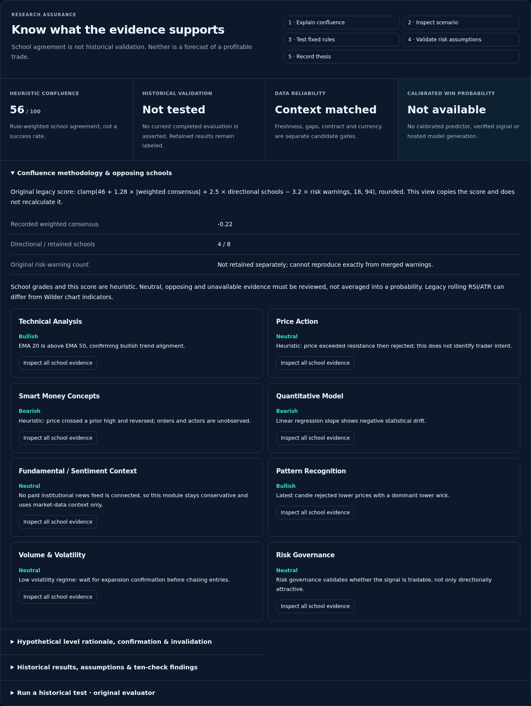
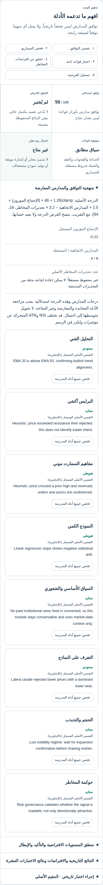

# Actual application — confidence and scenario review

Actual packaged app; fixed offline synthetic Yahoo/provider observations. Controlled eligible fixtures alter API responses explicitly; not live signals, probability calibration or Preview acceptance.

Baseline: `5e358d99c654f5c022d21d8de0e85efcaace36bc`. Same fixed clock and exact observation identity in each pair. Candidate prices and source context are asserted identical before/after.

26 verified profile pairs; 82 original PNG files with SHA-256 manifest.

[Full capture manifest](manifest.json) · [Complete local verification receipt](verification.json)

## Matched main-page captures

| Width / language / theme | Before | After |
| --- | --- | --- |
| 1440 / en / dark | [Rendered before](before/desk-1440-en-dark.png) | [Rendered after](after/desk-1440-en-dark.png) |
| 1440 / en / light | [Rendered before](before/desk-1440-en-light.png) | [Rendered after](after/desk-1440-en-light.png) |
| 1440 / ar / dark | [Rendered before](before/desk-1440-ar-dark.png) | [Rendered after](after/desk-1440-ar-dark.png) |
| 1440 / ar / light | [Rendered before](before/desk-1440-ar-light.png) | [Rendered after](after/desk-1440-ar-light.png) |
| 1024 / en / dark | [Rendered before](before/desk-1024-en-dark.png) | [Rendered after](after/desk-1024-en-dark.png) |
| 1024 / en / light | [Rendered before](before/desk-1024-en-light.png) | [Rendered after](after/desk-1024-en-light.png) |
| 1024 / ar / dark | [Rendered before](before/desk-1024-ar-dark.png) | [Rendered after](after/desk-1024-ar-dark.png) |
| 1024 / ar / light | [Rendered before](before/desk-1024-ar-light.png) | [Rendered after](after/desk-1024-ar-light.png) |
| 768 / en / dark | [Rendered before](before/desk-768-en-dark.png) | [Rendered after](after/desk-768-en-dark.png) |
| 768 / en / light | [Rendered before](before/desk-768-en-light.png) | [Rendered after](after/desk-768-en-light.png) |
| 768 / ar / dark | [Rendered before](before/desk-768-ar-dark.png) | [Rendered after](after/desk-768-ar-dark.png) |
| 768 / ar / light | [Rendered before](before/desk-768-ar-light.png) | [Rendered after](after/desk-768-ar-light.png) |
| 390 / en / dark | [Rendered before](before/desk-390-en-dark.png) | [Rendered after](after/desk-390-en-dark.png) |
| 390 / en / light | [Rendered before](before/desk-390-en-light.png) | [Rendered after](after/desk-390-en-light.png) |
| 390 / ar / dark | [Rendered before](before/desk-390-ar-dark.png) | [Rendered after](after/desk-390-ar-dark.png) |
| 390 / ar / light | [Rendered before](before/desk-390-ar-light.png) | [Rendered after](after/desk-390-ar-light.png) |
| 320 / en / dark | [Rendered before](before/desk-320-en-dark.png) | [Rendered after](after/desk-320-en-dark.png) |
| 320 / en / light | [Rendered before](before/desk-320-en-light.png) | [Rendered after](after/desk-320-en-light.png) |
| 320 / ar / dark | [Rendered before](before/desk-320-ar-dark.png) | [Rendered after](after/desk-320-ar-dark.png) |
| 320 / ar / light | [Rendered before](before/desk-320-ar-light.png) | [Rendered after](after/desk-320-ar-light.png) |

## Working review interactions

The same original form and evaluator are used inline; opening does not submit or alter assumptions. Historical results remain fixed-strategy evidence, not validation of a single trade. Arabic explicitly labels verbatim English engine reasons.

[Original evaluator, inline](after/trust-original-test-en-dark.png) · [Recorded historical outcomes](after/trust-historical-en-dark.png) · [Arabic historical review](after/trust-historical-ar-dark.png)

## Controlled eligible UI scenarios

These scenarios are deliberately modified test responses, not actual market recommendations. They verify exact copied levels, research-only labels and workflow presentation.

| Width / language / theme | Before | After |
| --- | --- | --- |
| 1440 / en / dark | [Before fixture](before-conditional/desk-1440-en-dark.png) | [After fixture](after-conditional/desk-1440-en-dark.png) |
| 1440 / ar / light | [Before fixture](before-conditional/desk-1440-ar-light.png) | [After fixture](after-conditional/desk-1440-ar-light.png) |
| 1024 / en / dark | [Before fixture](before-conditional/desk-1024-en-dark.png) | [After fixture](after-conditional/desk-1024-en-dark.png) |
| 1024 / ar / light | [Before fixture](before-conditional/desk-1024-ar-light.png) | [After fixture](after-conditional/desk-1024-ar-light.png) |
| 390 / en / dark | [Before fixture](before-conditional/desk-390-en-dark.png) | [After fixture](after-conditional/desk-390-en-dark.png) |
| 390 / ar / light | [Before fixture](before-conditional/desk-390-ar-light.png) | [After fixture](after-conditional/desk-390-ar-light.png) |

[Eligible level explanation — desktop](after-conditional/trust-candidate-1440-en-dark.png) · [Eligible explanation — Arabic mobile](after-conditional/trust-candidate-390-ar-light.png)

## Geometry and limits

The opening chart y-position is unchanged at all five measured widths (1,000px viewport):

| Width | Before chart y | After chart y |
| --- | --- | --- |
| 1440 | 427.23px | 427.23px |
| 1024 | 490.23px | 490.23px |
| 768 | 684.73px | 684.73px |
| 390 | 668.42px | 668.42px |
| 320 | 919.53px | 919.53px |

The source chart, original annotations and TradingView controls remain in place. The deliberate improvement is a connected, inspectable confidence/validation/scenario workflow; these captures do not claim a larger chart than the reviewed baseline. The 320px layout retains the baseline selector/chart stacking. Offline screenshots cannot verify a live TradingView feed or interactive protected Preview.

Complete gate results and exact-head hosted/Preview identity are reported separately after verification. No main merge or Production release is approved.
