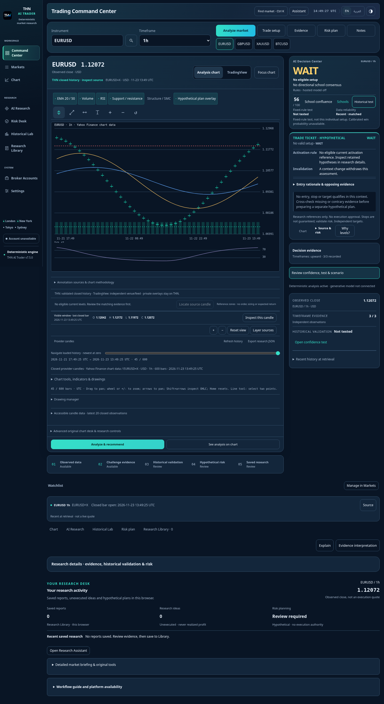
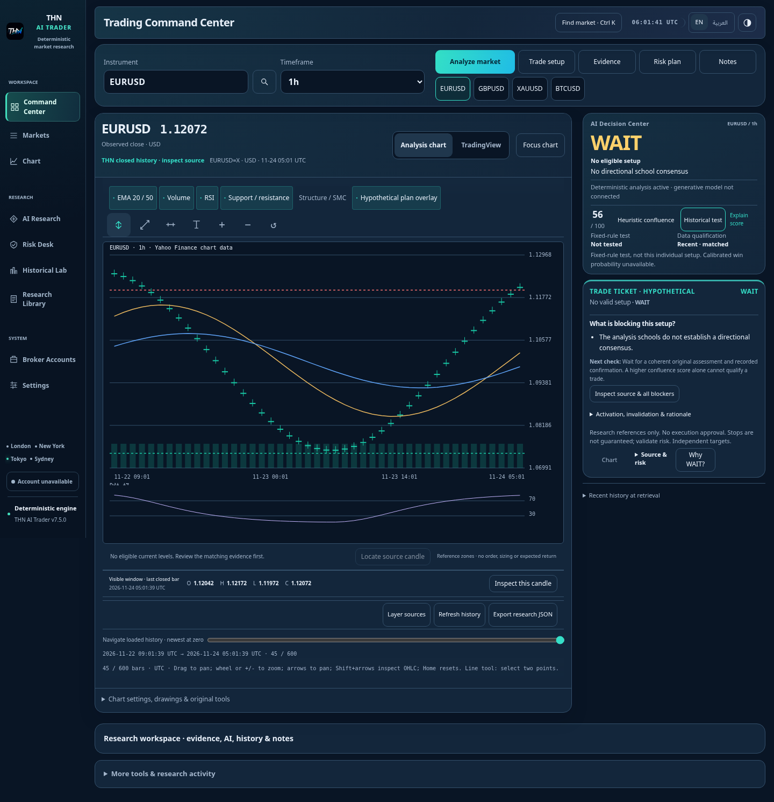
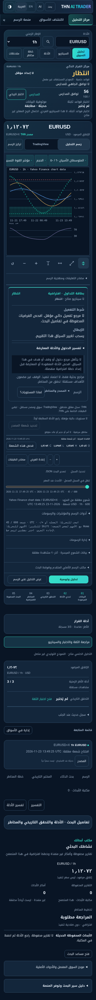
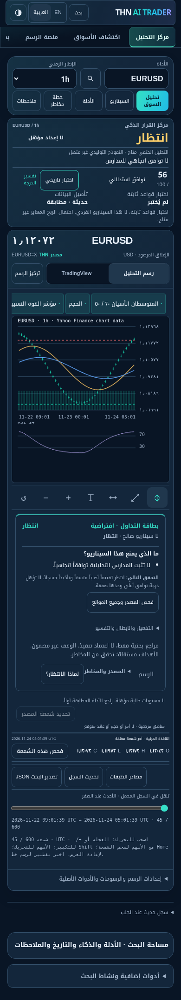

# Consolidated Command Center — actual browser evidence

Baseline: `3ed22362d9f574e2941b7b04d5fb29dc7edd4aba`, captured23 November2026.
Candidate captured24 November2026, Asia/Muscat, from the runtime hashes in
[measurements.json](measurements.json). Chromium151.0.7922.34, Playwright1.62.0
revision1234; viewport height1000. Images are unedited application screenshots.

**SYNTHETIC provider fixtures, not real-market or model qualification.** The same
original fixture family was used before/after; generated source timestamps differ.
The owner separately observed real Windows EURUSD chart/quality-WAIT at the
baseline. These captures do not supersede the prior real-model timeout or qualify
a real Entry/SL/Targets Ticket. No model was activated for these comparisons.

## Measured default-workspace changes

|Profile (both themes)|Before page height|After page height|Reduction|Chart height before/after|
|---|---:|---:|---:|---:|
|1440 EN/AR|2641px|1491px|43.5%|560 /560px|
|768 EN/AR|3703px|2141px|42.2%|480 /480px|
|390 EN|4233px|2249px|46.9%|330 /330px|
|390 AR|4059px|2153px|47.0%|330 /330px|

The chart starts at449.7px on desktop (before457.7),675.3px at768 (before672.3),
and681.1px at390 (before678.1). The3px tablet/mobile trade-off preserves an explicit
model-availability statement. The chart engine and dimensions are unchanged.
One original Analyze owner replaces duplicate main-page Analyze paths. Advanced
tools remain available through native disclosures; this reduction is not deletion
of research, chart, Library, evaluator or planner functionality.

## Desktop English — before / after

## Arabic mobile — before / after

## All12 matched language/theme/size profiles

|Profile|Before|After|
|---|---|---|
|1440 EN dark|[PNG](before-1440-en-dark.png)|[PNG](after-1440-en-dark.png)|
|1440 EN light|[PNG](before-1440-en-light.png)|[PNG](after-1440-en-light.png)|
|1440 AR dark|[PNG](before-1440-ar-dark.png)|[PNG](after-1440-ar-dark.png)|
|1440 AR light|[PNG](before-1440-ar-light.png)|[PNG](after-1440-ar-light.png)|
|768 EN dark|[PNG](before-768-en-dark.png)|[PNG](after-768-en-dark.png)|
|768 EN light|[PNG](before-768-en-light.png)|[PNG](after-768-en-light.png)|
|768 AR dark|[PNG](before-768-ar-dark.png)|[PNG](after-768-ar-dark.png)|
|768 AR light|[PNG](before-768-ar-light.png)|[PNG](after-768-ar-light.png)|
|390 EN dark|[PNG](before-390-en-dark.png)|[PNG](after-390-en-dark.png)|
|390 EN light|[PNG](before-390-en-light.png)|[PNG](after-390-en-light.png)|
|390 AR dark|[PNG](before-390-ar-dark.png)|[PNG](after-390-ar-dark.png)|
|390 AR light|[PNG](before-390-ar-light.png)|[PNG](after-390-ar-light.png)|

Additional full pages: [desktop AR light before](before-1440-ar-light-full.png),
[after](after-1440-ar-light-full.png), [mobile EN light before](before-390-en-light-full.png),
[after](after-390-en-light-full.png).

## Functional and acceptance boundaries

Actual rendered quality-blocked states: [desktop EN dark](synthetic-quality-WAIT-1440-en-dark.png)
and [mobile AR dark](synthetic-quality-WAIT-390-ar-dark.png). These introduce one
invalid row into a synthetic upstream response; the original adapter rejects it.
The default comparison above instead has clean synthetic observations and neutral
consensus. Neither fixture establishes real-source eligibility.

Progressive detail: [original confidence explanation](synthetic-confidence-expanded-1440-en-light.png)
and [original source/blocker inspector](synthetic-source-blockers-1440-en-light.png).
These are the actual inline owners reached from the compact Decision Center and
Ticket, not separately designed panels or generated images.

Fallback-font Ticket: [1024 EN dark](synthetic-day5-dejavu-1024-en-dark.png) and
[1024 AR light](synthetic-day5-dejavu-1024-ar-light.png). The original test verifies
Chromium actually renders DejaVu Sans through CDP, not merely a CSS declaration.
All eight desktop font profiles pass with at least15.9px first-viewport clearance.
These controlled BUY references remain **synthetic research fixtures**, not a
real-provider qualified Ticket, model prediction or execution recommendation.

Complete original risk binding: [desktop EURUSD viewport](synthetic-day8-EURUSD-1440-en-dark.png),
[Arabic mobile Ticket element capture](synthetic-day8-EURUSD-390-ar-light-ticket.png),
and [expanded original risk review](synthetic-day8-EURUSD-1440-en-dark-risk-viewport.png).
All24 Day8 BUY/SELL profiles passed exact retained-level/risk binding and
accessibility checks. These are **controlled synthetic admission fixtures**;
the real Windows quality-blocked WAIT is not replaced with these prices.

The new quality-WAIT suite uses an explicitly invalid synthetic upstream OHLC
row. The unchanged original adapter rejects it; confluence never overrides that
blocker. Tests also exercise one original analysis request, no model calls,
inline confidence/history/source navigation, focus/Escape return, preserved notes,
chart identity and no order requests. Original positive Ticket fixtures remain
separate evidence of UI/risk contracts, never real market qualification.

See [implementation and honest readiness matrix](../../COMMAND-CENTER-CONSOLIDATION-20261123.md)
and [the existing owner-device acceptance workflow](../../DAY9-OWNER-ACCEPTANCE.md).
PR23 remains draft. November26 is an acceptance review, not automatic GO.

## Final local release checks

[Machine-readable verification receipt](verification.json):540 core tests,
21 security tests,10 system tests and all51 browser/accessibility suites passed.
All50 original browser suites remain mandatory, alongside the new12-profile
quality-WAIT suite. Build, lint, workflow, dependency audit, frozen-lock installation,
production packaging, source/numerical integrity and Git fsck passed. The source
hash receipt matches the captured runtime; protected engines/model contracts are
unchanged. Original browser assert counts and numeric constants are retained;
approved navigation/focus/wording changes and read-only captures are documented.

Earlier navigation, contrast, duplicate-row and DejaVu Ticket failures were fixed,
then both complete shards were rerun successfully. Hosted exact-head CI and
existing-project Preview identity are checked after the authorized feature-branch
push and reported separately. No main/Production or real-model/Ticket acceptance
is inferred from local green tests.
