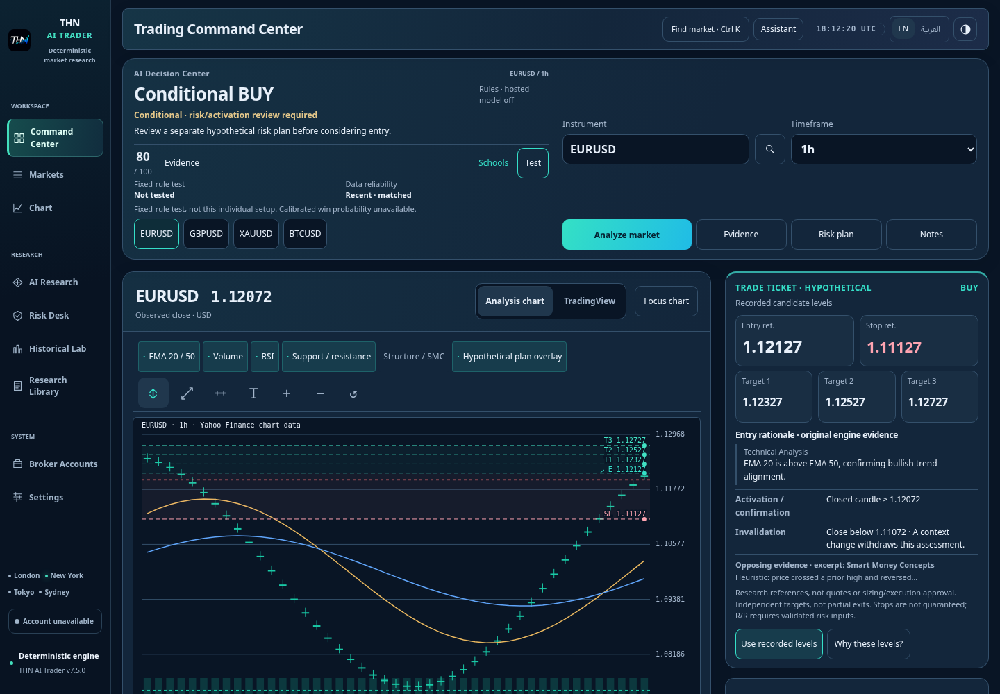
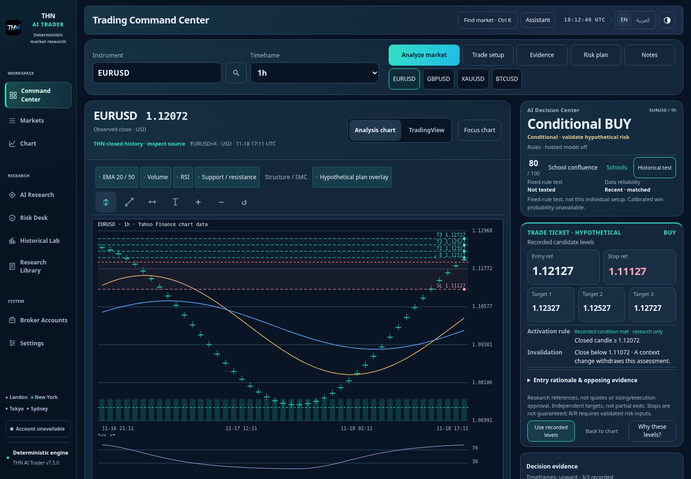
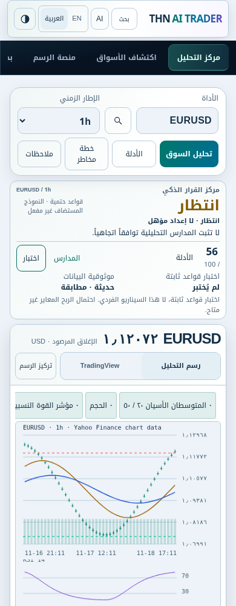
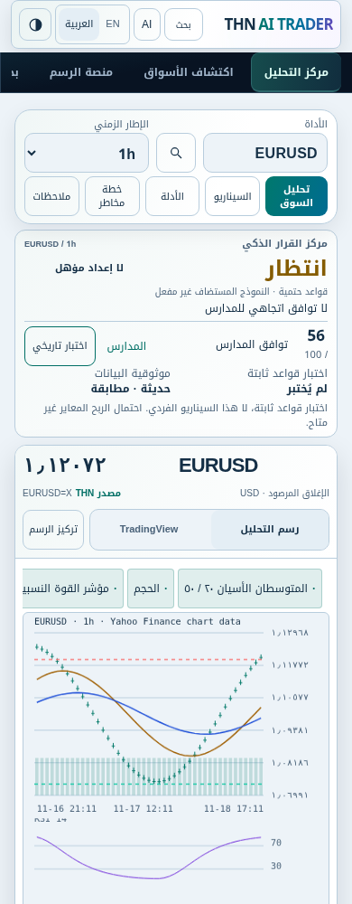

# Day5 actual application gallery

**All images are genuine application renders using offline synthetic provider observations.** Conditional/SELL/eligible cases use controlled analysis fixtures. These are not live signals, real-model output, proof of profitable performance or Production acceptance. Images are unaltered browser screenshots.

Before: exact public files from `6275939fd7d2dd892a37d2298cc1c28455baaa9e`. After: the frozen packaged candidate, linked to its final commit through the recorded public-file fingerprint. The same running fixture backend supplies all pairs. Every pair has identical dataset/bar identity, confluence and copied candidate values. The ordinary wall clock differs.

After public-tree SHA256: `4ce90cdae33c34324e9acb2b8e4ff306adf93fa8bb967be0f30ba3fbed839758`.

## Measured opening fold

All following profiles are1000px tall. Chart Y is measured from the opening viewport; visible pixels are measured, not a CSS estimate.

| Width / language | Chart Y before → after | Visible chart before → after | Chart width before → after | Mobile ticket Y before → after |
| --- | ---: | ---: | ---: | ---: |
| 1440 / en | 615.2 → 457.7 | 384.8 → 542.3 | 816 → 856 | — |
| 1440 / ar | 617.9 → 457.7 | 382.1 → 542.3 | 816 → 856 | — |
| 1024 / en | 691.2 → 477.7 | 308.8 → 522.3 | 500 → 560 | — |
| 1024 / ar | 693.9 → 477.7 | 306.1 → 522.3 | 500 → 560 | — |
| 390 / en | 713.8 → 678.1 | 286.2 → 321.9 | 338 → 338 | 2068.6 → 1165.1 |
| 390 / ar | 696.4 → 678.1 | 303.6 → 321.9 | 338 → 338 | 2031.2 → 1165.1 |

Trade-offs: the desktop decision moves from the large hero into the chart-side column. The ticket starts lower than the old desktop ticket, but Entry/SL/T1–T3 remain in the first fold in the controlled candidate profiles. On mobile, the ticket follows the chart rather than the complete audit-control stack and is also one click away. It is not simultaneously beside the chart in the opening viewport. Deep original controls remain available.

## Paired opening views

| Profile | WAIT before | WAIT after | Conditional before | Conditional after |
| --- | --- | --- | --- | --- |
| 1440-en-dark | [Before](before-wait-1440-en-dark.png) | [After](after-wait-1440-en-dark.png) | [Before](before-conditional-1440-en-dark.png) | [After](after-conditional-1440-en-dark.png) |
| 1440-ar-light | [Before](before-wait-1440-ar-light.png) | [After](after-wait-1440-ar-light.png) | [Before](before-conditional-1440-ar-light.png) | [After](after-conditional-1440-ar-light.png) |
| 1024-en-dark | [Before](before-wait-1024-en-dark.png) | [After](after-wait-1024-en-dark.png) | [Before](before-conditional-1024-en-dark.png) | [After](after-conditional-1024-en-dark.png) |
| 1024-ar-light | [Before](before-wait-1024-ar-light.png) | [After](after-wait-1024-ar-light.png) | [Before](before-conditional-1024-ar-light.png) | [After](after-conditional-1024-ar-light.png) |
| 390-en-dark | [Before](before-wait-390-en-dark.png) | [After](after-wait-390-en-dark.png) | [Before](before-conditional-390-en-dark.png) | [After](after-conditional-390-en-dark.png) |
| 390-ar-light | [Before](before-wait-390-ar-light.png) | [After](after-wait-390-ar-light.png) | [Before](before-conditional-390-ar-light.png) | [After](after-conditional-390-ar-light.png) |

### Desktop conditional example

Before — exact starting app, controlled fixture:



After — same observations/levels, original chart and ticket:



### Arabic mobile example

Before — opening WAIT:



After — opening WAIT:



## Ticket, eligible research and expanded evidence

- Mobile conditional ticket: [before EN](before-conditional-390-en-dark-ticket.png), [after EN](after-conditional-390-en-dark-ticket.png), [before AR](before-conditional-390-ar-light-ticket.png), [after AR](after-conditional-390-ar-light-ticket.png). The corrected AR confirmation operator is explicitly LTR-isolated; no rule or price changed.
- Eligible **research**, not an order: [1440-en-dark](after-eligible-1440-en-dark.png), [1440-ar-light](after-eligible-1440-ar-light.png), [1024-en-dark](after-eligible-1024-en-dark.png), [1024-ar-light](after-eligible-1024-ar-light.png), [390-en-dark](after-eligible-390-en-dark.png), [390-ar-light](after-eligible-390-ar-light.png).
- [Expanded school confidence](expanded-confidence.png); [actual original historical evaluator findings EN](historical-validation-en.png), [AR](historical-validation-ar.png). Evaluation outcomes use synthetic history and do not validate the individual proposed trade.
- Full-page context: [WAIT desktop before](before-wait-1440-en-dark-full.png), [after](after-wait-1440-en-dark-full.png); [conditional AR mobile before](before-conditional-390-ar-light-full.png), [after](after-conditional-390-ar-light-full.png).

## Shorter real-phone viewport:390 ×844

These supplementary captures avoid implying that1000px results describe every phone. The decision/confidence remains visible; only part of the chart initially fits. Use Focus chart, native scrolling or the direct Trade setup action.

| Language / theme | WAIT before | WAIT after | Conditional before | Conditional after |
| --- | --- | --- | --- | --- |
| 390-en-dark | [Before](before-wait-390-en-dark-844.png) | [After](after-wait-390-en-dark-844.png) | [Before](before-conditional-390-en-dark-844.png) | [After](after-conditional-390-en-dark-844.png) |
| 390-ar-light | [Before](before-wait-390-ar-light-844.png) | [After](after-wait-390-ar-light-844.png) | [Before](before-conditional-390-ar-light-844.png) | [After](after-conditional-390-ar-light-844.png) |

## Reproduce without checkout or deployment

Use the existing pinned Python Playwright1.62.0 / Chromium151.0.7922.34 revision1234 environment. No install/pull or model is performed. Start one offline fixture server and keep it running for **all** captures so the source sample does not change:

```bash
npm run package:production
VERCEL=1 THN_AI_ENABLED=0 THN_LOCAL_PAPER=0 node --import ./tests/browser-provider.js tests/packaged-launch.mjs
```

In another shell, replace40809 below with the printed THN_TEST_PORT:

```bash
python3 scripts/qa/capture-command-center.py --url http://127.0.0.1:40809 --before --case wait --output /tmp/thn-day5-before-wait
python3 scripts/qa/capture-command-center.py --url http://127.0.0.1:40809 --before --case conditional --output /tmp/thn-day5-before-conditional
python3 scripts/qa/capture-command-center.py --url http://127.0.0.1:40809 --case wait --output /tmp/thn-day5-after-wait
python3 scripts/qa/capture-command-center.py --url http://127.0.0.1:40809 --case conditional --expanded --historical --output /tmp/thn-day5-after-conditional
python3 scripts/qa/capture-command-center.py --url http://127.0.0.1:40809 --case eligible --output /tmp/thn-day5-after-eligible
```

The tool reads baseline public files from Git without changing branches/worktree, checks unchanged server source and execution-off health, and checks that the package matches the working tree. Preserve receipts. Future fixture samples differ in timestamp/hash: compare only within the same server session. Financial formulas and stored research records are never migrated.

## Evidence files

- [Exact geometry and source comparison](measurements.json).
- [Protected engines/recommendation function and109 unchanged original test fingerprints](preserved-contracts.json).
- [Before WAIT receipt](before-wait-receipt.json), [before conditional](before-conditional-receipt.json), [after WAIT](after-wait-receipt.json), [after conditional](after-conditional-receipt.json), [after eligible](after-eligible-receipt.json).
- [Final local verification receipt](verification.json). Hosted CI/Preview identity are separately reported for the actual pushed commit.
