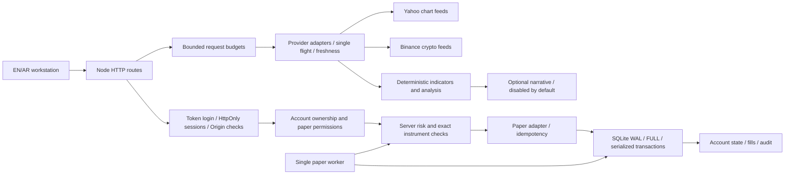

# Staging engineering audit and validation

This report covers the isolated `Thaniyan/thn-ai-trader-staging` checkout and the local-only changes accompanying it. It supersedes earlier readiness statements where they conflict. It is not a production release approval or proof of provider reliability.

## Source and scope

- Origin: `https://github.com/Thaniyan/thn-ai-trader-staging.git`.
- Initial HEAD: `374bc7808c0b6cee2072a4ced70f026888548465`, exactly the requested baseline.
- Initial branch: cloud task branch `work`; initial tracked and untracked state was clean.
- Read-only Git access returned the same staging remote HEAD. No token extraction was needed.
- Runtime: Linux, Node 24.19.0 (built-in SQLite), Bun 1.4.2, Python Playwright, Chromium. Caddy 2.10.2 was downloaded from its official release and verified against its official SHA-512 manifest.
- No production checkout, WSL2 machine, production database, Vercel settings or broker credentials were accessed or modified. No push, deployment, merge, PR or publication was performed.
- The committed release's exact SHA is recorded by the generated package's `manifest.json`; the initial SHA above is historical baseline evidence.

## Architecture and request lifecycle

`server.js` supplies routing, response headers, input validation, analysis assembly and order coordination. It is still a large module; this change does not pretend to complete a modular architectural rewrite.

| Component | Actual responsibilities and boundaries |
| --- | --- |
| `server/auth.js` | Configured token identities; timing-safe token comparison; bounded eight-hour in-memory sessions; HttpOnly/SameSite=Strict cookies; Secure cookies under the configured HTTPS origin; Origin checks and account ownership. Restart revokes sessions. No public signup or password-reset service. |
| `server/marketData.js` | Normalization, Yahoo chart and Binance candle/ticker requests, identity checks, closed-bar validation, quote/candle freshness, H4 aggregation, four active provider operations, bounded queue, single-flight requests, short success cache and bounded failure cooldowns. No synthetic fallback or verified holiday calendar. |
| `server/indicators.js` and analysis assembly | EMA, rolling RSI/ATR, MACD, Bollinger, price structure and heuristic confluence. Independent D1/H4/H1/M15 fetching. Confidence is not a probability. Volume-at-price and SMC classifications are model approximations. |
| `server/openai.js` | Optional authenticated narrative only, schema validation, bounded requests/concurrency, eight-second timeout and narrative cache. Does not modify numeric levels. Disabled in the prepared cloud/local runtime. Tests use fixtures and incur no API costs. |
| `server/storage.js` | Built-in SQLite, WAL and FULL synchronization, exclusive writer lock, serialized BEGIN IMMEDIATE transactions, bounded wait queue, state/idempotency/audit/fill tables and ledger pagination index. No multi-instance writer support. |
| `server/accountStore.js` / encryption | Account DTOs, finite-number validation, zero preservation, credential encryption with AES-256-GCM, key authentication on recovery and durable idempotency records. Missing DTO status/permission now reports unverified/read-only. |
| `server/riskEngine.js` | Supported paper contract specs, currency conversion, protective stops, tick/volume checks, margin and risk ceilings: 2% single trade, 6% aggregate, 5% daily realized loss, 15 open/pending positions, maximum leverage 200. USD settlement is supported; unsupported conversion blocks execution. |
| `server/brokerAdapters.js` | Simulated paper fills/limits/closes. External Exness/XTB/MT5 adapters fail closed; backend also prohibits external execution. Approximate spread is 0.8 pip round trip; no calibrated commission/swap model. |
| `server/paperWorker.js` | One non-overlapping worker, pending-order crossings, expiry, TP/SL checks, mark-to-market and persistence. It stops processing whenever the host/backend is stopped. Unavailable exact data blocks fills and closes. |
| `public/app.js` / HTML / CSS | Functional nine-view workstation, bilingual navigation, RTL/LTR, charts, scanner, journal, account selection, browser sessions, risk preview and paper ticket. Local browser state is not authoritative account state. |
| Local staging kit | Caddy HTTPS/static frontend → loopback Node API → private SQLite; managed process identities, graceful restart, backup/restore, lock recovery and generated isolated credentials. Windows trust and forwarding cannot be inferred from Linux cloud checks. |

The fill API appends server records; no API rewrites fills. Audit immutability is additionally enforced by SQLite triggers. This is not a claim that an operator with arbitrary filesystem/SQL access cannot alter the database.

## Confirmed findings and corrections

Severity denotes staging impact, not an assertion of production exploitation. Every finding below was confirmed by source inspection and/or a deterministic reproduction. Historical WSL logs were unavailable.

| ID / severity | Reproduction and root cause | Correction | Regression evidence |
| --- | --- | --- | --- |
| G1 / High | Click Gold during a provider outage: `/api/analyze` throws a market exception; the shared catch discarded its machine-readable code. HTTP 502 originated in the application and does not establish a Caddy fault. | Preserve error code, Retry-After and correlation ID; sanitized logs share that ID. | Gold outage API test and real button browser test. |
| G2 / High | All quote fetches fail: batch swallowed individual failures and returned HTTP 200, `ok:true`, empty quotes. | Return UNAVAILABLE with HTTP 503/429, instrument error map, retry delay and correlation. Partial data remains explicitly DEGRADED. | Total outage, quota and partial batch tests. |
| G3 / High | Yahoo HTTP 429 became a generic market 502; failed requests immediately repeated provider calls. | Parse upstream Retry-After, propagate PROVIDER_RATE_LIMITED and retain bounded per-instrument/timeframe negative cache. No stale success fallback. | Provider quota test; concurrent Gold failures result in only one attempt per Yahoo host during cooldown. |
| G4 / Medium | Five-second browser polling ignored quota responses. Synchronization could overlap account/ledger calls. The provider request budget is shared with analysis/scanning. Multiple tabs/scans can consume it. | Completion-based polling with 15-second minimum, hidden-page pause, single-flight synchronization, bounded exponential backoff/jitter and Retry-After suspension. Analysis has single-flight and a 45-second deadline. | Browser concurrent quote and 429 cooldown tests. This does not prove the exact source of the user's historical 429s. |
| G5 / High | Gold uses `GC=F`, a futures proxy for XAUUSD, while paper market validation previously did not require exact instrument identity. | Proxy data remains analysis-only; WAIT/no entry levels and paper order rejection. Both UI and backend reject proxy authorization. | Fresh Gold proxy rejection test; historical proxy opportunity checks retained. |
| M1 / High | Success cache was keyed by Yahoo symbol, allowing BTCUSD/BTCUSDT to reuse the first request's displayed identity/proxy classification. | Cache/failure/single-flight keys use normalized display identity and timeframe. | USD/USDT identity cache regression. |
| M2 / Medium | Cached provenance could remain fresh while the underlying quote crossed the freshness boundary. | Recompute quote and candle freshness on every success-cache read without changing quote timestamps. | Cached quote boundary regression. |
| A1 / High | Switch accounts: selected account received prior positions, realized PnL and trade counts; connection was forced true. | Keep the selected server DTO intact. Clear account caches after confirmed authorization loss; permission labels derive from observed paper status. | Browser zero-balance/account-switch isolation regression. |
| A2 / Medium | Default UI supplied a connected $50,000 account before authentication; paper account selector displayed LIVE REAL. | Locked default has unavailable financial values; PAPER/DISABLED tags, paper-only permissions and authenticated status labels. | Browser authentication, selector and logout checks; zero-value regression retained. |
| U1 / High | Dashboard contained hardcoded BUY/SELL setups and numerical spreads/change percentages. A price table supplied invented quote fallbacks. | Remove invented price table and static recommendations. Populate analysis cards from observed current data and recent activity from server fills. Empty data stays unavailable. | Browser outage assertions; source review; all-view navigation checks. |
| U2 / Medium | Static feed badges claimed live interbank feeds, CoinGecko/calendar connectivity and enabled trading. Optional AI label said local AI active. Risk descriptions disagreed with backend limits. | State-derived provider/account badges, unavailable calendar, deterministic/external-AI distinction, correct 2%/6%/5% risk disclosures and localized brokerFunding. | DOM/browser review and fixture data contracts. |
| U3 / Medium | Failed Gold analysis left the allocation panel saying Awaiting Instrument Analysis, and prior output could remain visible as if current. | Explicit loading/error/no-qualified-setup states; WAIT after failure; visible diagnostic ID; retry cooldown; controls restored on every completion. | Actual Gold button browser scenario. |
| Q1 / High | `simulateBacktest` generated win rate and returns from heuristic confidence and assumed outcomes rather than historical evaluation. | Remove projected performance generation; return an unavailable historical-performance contract. Explicit opt-in synthetic sample journal preview remains labeled and separate from real fills. | Existing non-historical backtest assertion, browser journal isolation and source review. |
| Q2 / High | Tiny paper accounts could pass risk/margin checks when positive sub-cent liabilities rounded down to zero or a smaller margin. | Round budget reservations upward to cents; use `slRiskUpperBound` for stop-budget enforcement, pending reservations, positions and refresh. Preserve legacy nearest-cent `slDollars` display contract and cent-rounded PnL. | Sub-cent risk/margin rejection regression, existing risk vectors and paper accounting suites. |
| B1 / Medium | The only existing browser suite bypassed CSP. | Enforce application CSP and use function predicates compatible with it. Existing protections remain enabled. | Full browser run under original CSP. |
| X1 / Medium | Two selects lacked accessible names and a scrollable report lacked keyboard focus. | Localized accessible names, focusable report, visible focus, skip link, aria-current, live/busy status, reduced-motion support and touch-sized mobile controls. | 18 EN/AR axe scans; browser viewport checks. |

## Gold incident: what is and is not established

The application itself generates market-data 502 responses. Provider outages/429s reproduce the reported failure path with deterministic fixtures. An initial cloud probe was denied by the proxy with HTTP 403 and the runtime correctly returned MARKET_UNAVAILABLE. Later final-release checks reached Yahoo: EURUSD had fresh/current exact-identity data, Gold had stale GC=F proxy data, and BTCUSDT fell back to a mismatched BTC-USD feed. A separate direct Yahoo probe returned HTTP 429. Runtime network-policy enforcement was subsequently reported as unknown. These observations establish neither stable provider access nor the cause on the user's WSL machine.

Historical Yahoo responses, console response bodies, Caddy logs and runtime configuration from the user's machine were not available. The original incident's upstream quota, stale-data, timeout and polling contributions therefore remain distinguishable possibilities. Response correlation IDs, error codes, Retry-After and provider readiness now make that diagnosis concrete. Optional missing AI credentials are not required for deterministic analysis and were not established as the original cause.

The Gold feed remains a futures proxy. Even after Yahoo access is allowed, it cannot qualify as exact executable XAUUSD evidence. A verified exact-instrument source is an external prerequisite; no subscription or paid infrastructure was purchased or proposed as required setup.

## Validation matrix

The automated regression suites use isolated market/AI fixtures. Separately, a bounded current-instance EURUSD paper lifecycle was exercised against actual Yahoo responses without provider fixtures. Neither category establishes external-provider uptime, paid AI accuracy or broker connectivity.

| Area | Result and limits |
| --- | --- |
| Frozen dependency install | PASS, Bun 1.4.2; repeat install reported no changes. Node 24.19.0 is compatible. Manifest and lockfile unchanged. |
| Build / lint | PASS. These repository scripts perform syntax checks, not a bundled build or semantic type/lint analysis. Lint checks 17 application/helper files. |
| Node regression tests | PASS, 50 tests, zero failed/cancelled/skipped. Includes new incident/cache/AI-failure/financial-boundary regressions and historical security/persistence coverage. |
| System runner | PASS, 10 system checks. Health, vault/account state, authoritative risk, invalid TP, order/idempotency, close/settlement, reset, reconciliation, audit and quote aggregation. |
| Browser | PASS with CSP enforced. Actual cookie login and paper ticket interaction; Gold button outage/cooldown; quote quota/single-flight; account isolation; scanner cancellation; cross-tab notifications; ledger cursor; zero values; charts/DPR2 and all nine EN/AR views at 390/768/1440 widths. Provider fixtures and explicit browser response interception are instrumented conditions. |
| Accessibility | PASS, 18 desktop EN/AR view scans with axe-core 4.11.1 WCAG A/AA rules. Same-origin audit script instrumentation, unchanged CSP. No detected violations; incomplete checks and manual keyboard/screen-reader review remain separate. No blanket WCAG certification. |
| HTTPS / security / restart | PASS in disposable cloud Linux release-kit copy with Caddy. TLS verification used the generated CA, no insecure TLS option. Static/API routing, Secure/HttpOnly/SameSite cookies, CSRF, ownership, anonymous rejection, external broker rejection, session revocation and account persistence verified. |
| Backup / restore | PASS: private consistent SQLite snapshot, integrity/checksum verification, graceful stop, archive of current state, matching-key restore, restart and authenticated verification. Existing wrong/missing-key and dead/live-writer recovery tests also passed. |
| Bounded load | PASS, 20 simultaneous fixture scans × 3 instruments; p50 294.5 ms, p95 403.0 ms, p99 413.0 ms on the measured run. No production throughput, latency SLO or provider quota conclusion. |
| Dependency advisory audit | PASS: Bun audit reported no vulnerabilities among 41 packages. This is the advisory database result at test time, not a guarantee against undisclosed vulnerabilities. |
| Current cloud runtime | PASS for loopback startup, health, protected APIs, generated isolated authentication and safe Gold failure. Install/start helper behavior and repeat installation exercised. |
| Real provider smoke checks | PARTIAL PASS: final Yahoo EURUSD quote/candles were fresh/current; release-kit market-check passed. Gold was stale and a futures proxy; BTCUSDT fell back to a USD proxy. Direct Yahoo probe also returned 429. Binance response success and ongoing reliability remain UNVERIFIED. Domains are saved in a draft; runtime enforcement is unknown and draft save does not prove application. |
| Actual-feed paper lifecycle | PASS on a disposable cloud account: creation, buy, idempotent replay, partial/full close, sell/full close, limit reservation/cancel, released margin, three finite settled fills and secondary-owner denial. No provider fixtures or external broker execution. Completed with zero open positions/pending orders. |
| External AI | DISABLED in runtime. Valid/invalid output, upstream 503/429 and timeout tested with fixtures; numeric levels protected. No paid calls made. |
| Live brokers | DISABLED, fail-closed tests passed for every external adapter. Never activated. |
| Windows/WSL2 trust and continuity | UNRUN: user machine is separate. Upgrade and verification procedure supplied. Linux cloud HTTPS is not Windows trust-store evidence. |

## Security and operational review

Authentication, ownership, CSRF/Origin, CSP, cookies, bounded bodies/queues, risk ceilings, encryption authentication and exclusive writer/worker behavior were retained. Sensitive values were generated only in private disposable/cloud state outside tracked source. Logs for request failures use correlation, status, code and method without credentials, payloads or account balances.

SQLite transactions serialize account mutations and idempotency/fill writes. Waiting requests are bounded, but slow provider requests can hold the single state writer. This remains a local single-instance architecture, not a horizontally scalable service. Restart revokes sessions by design. Writer recovery must establish no live writer; no lock was removed to bypass exclusivity.

Paper assumptions remain approximate: modeled spread, contract sizes, leverage, rounded USD settlement, no commissions/swaps, uncertain venue/calendar licensing and no broker-calibrated slippage. Budget rounding is conservative, but JavaScript binary numbers are still used; the system is not a production decimal accounting engine. Conservative freshness can legitimately reject market-closed/session-gap data.

Some server diagnostics and technical analysis text remain English in Arabic mode. Primary navigation, core account/ticket headings, permissions and status labels are bilingual; further language QA and manual assistive-technology testing remain necessary. Technical labels must not be silently substituted with unrelated Arabic advice: original specific reasons/warnings are preserved.

## Final review and release assessment

A separate final review of changed data/permission paths, saved setup instructions, browser scenarios and release boundaries was performed after implementation. It does not claim a second-person or external security certification.

The deterministic development workflow, fixture-based paper suite and a bounded actual-feed EURUSD paper lifecycle are verified. The isolated local HTTPS/recovery workflow is verified. This is a useful staging candidate for review, not full live-data readiness, production readiness or completion of every future integration.

Risk-ordered remaining work:

1. **Required for broader live-data readiness:** verify stable active network policy and repeat quota/freshness checks; the saved domain draft is available for review, and environment publication needs separate explicit approval. Exact XAUUSD sourcing remains required despite successful Yahoo futures access.
2. **Required on the user's computer:** test the new package in a sibling WSL2 directory, establish trusted HTTPS/loopback, verify sessions, real data and paper-only journeys. Do not overwrite the existing instance.
3. **Required before any wider release claim:** manual Arabic/English content, keyboard/screen-reader, contrast under all themes, real provider soak/quota and existing-position compatibility review.
4. **Future engineering:** verified exchange/holiday calendars, exact venue coverage, calibrated paper fees/slippage, historical strategy evaluation, decimal accounting, retention/rotation/storage limits and modular server decomposition. These were not fabricated or enabled to make staging appear complete.

The local commits are unpushed and the environment is unpublished. Fresh-task restoration of local-only commits has not been verified; do not assume a fresh checkout of remote main contains this candidate.

No schema migration was introduced. New response fields are additive, but wholly unavailable quote batches now correctly return 503/429. Proxy orders are rejected. Existing proxy positions may remain blocked from fills/closes until exact data is available; review them without silently substituting prices. Budget reservations can rise by one cent and tiny accounts may reject orders previously accepted due to rounding. See [upgrade and rollback](staging-upgrade.md).
